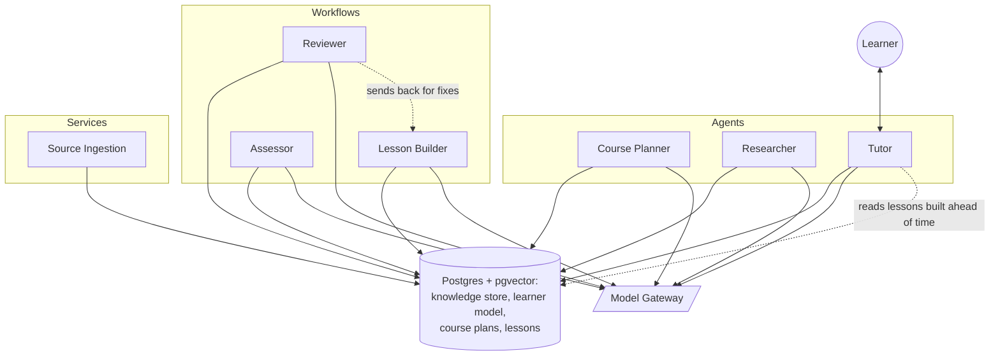
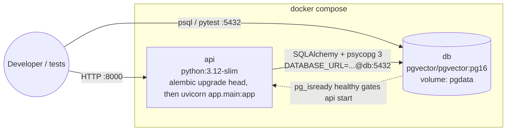

# Architecture Overview

## Principles

- Use agents only where the next step can't be known in advance. Everything else is a fixed workflow or plain code.
- Agents share state through the database, not by passing conversations to each other. See [ADR 0001](../decisions/0001-agents-share-state-through-database.md).
- Expensive work (research, lesson building, review) happens ahead of the learner. Only the Tutor runs live.
- Model tiers match the job. All model calls go through one internal gateway module.
- The knowledge store doubles as a cache.
- Every workflow has a defined input and output so it can be evaluated on its own.

## Agents

Agents are used where the next step genuinely can't be known in advance.

- **Course Planner** (strongest model) — turns goal, context, and sources into a course plan; edits on request; replans after assessments.
- **Researcher** (mid-tier model) — finds, vets, and summarizes web information for upcoming concepts in the background, writing to the knowledge store.
- **Tutor** (fast model) — the live chat and voice conversation; decides when to answer, retrieve, search, show a figure, or start an exercise.

## Workflows

Workflows are fixed pipelines with a defined input and output, prepared ahead of the learner's session.

- **Lesson Builder** (mid-tier) — context packet in, validated slide data out.
- **Reviewer** (strong) — checks lessons for accuracy against sources and alignment with the course goal; sends them back for fixes.
- **Assessor** (mid-tier, vision when needed) — grades exercises, observation answers, and homework against rubrics.

## Services

- **Knowledge store** — content, concept tags, source type, verification status, date gathered, taught-to-learner status. Doubles as a cache.
- **Learner model** — statistics first, then a trained knowledge-tracing model.
- **Source ingestion** — background processing, relevance checks, concept extraction.

## Data flow

All agents and workflows read and write the shared database; none pass conversation state directly to one another. All model calls route through the gateway, regardless of which agent or workflow is calling.

## Runtime / local stack

The backend runs as one FastAPI service (`backend/app`) talking to one Postgres 16 database with the pgvector extension. Agents, workflows, and services above will be modules inside this backend and will share state through this database. Locally, both run under Docker Compose. See [PLAT-01](../features/PLAT-01-backend-skeleton.md).

- Configuration comes from environment variables (`DATABASE_URL`, `ENVIRONMENT`) read by `app/config.py`.
- Schema changes go through Alembic migrations. For local dev they run when the API container starts. PLAT-04 will move them to a deploy step.
- `/health` is a liveness probe only. It doesn't check the database.
- CI runs the same `pgvector/pgvector:pg16` image as a service container, so the migration tests run against real Postgres.
