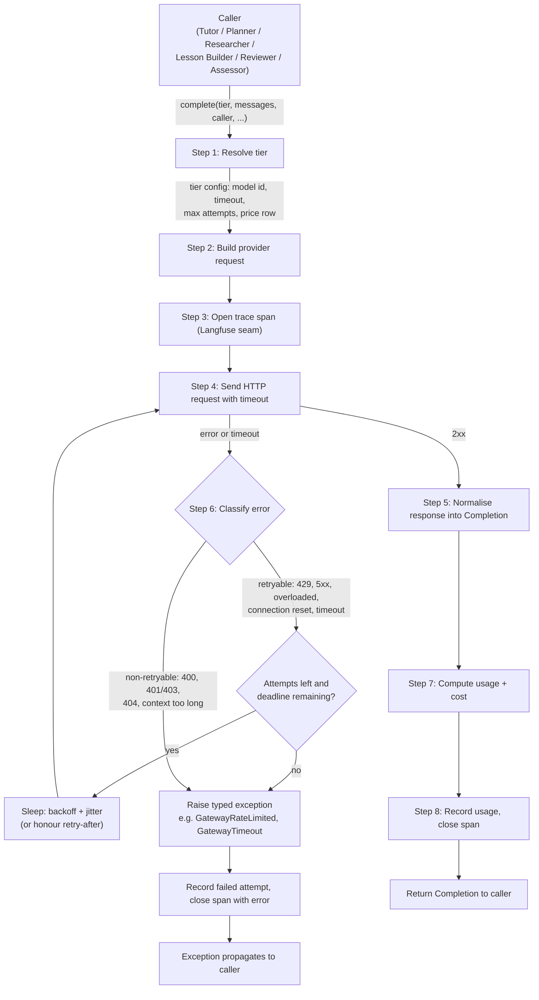
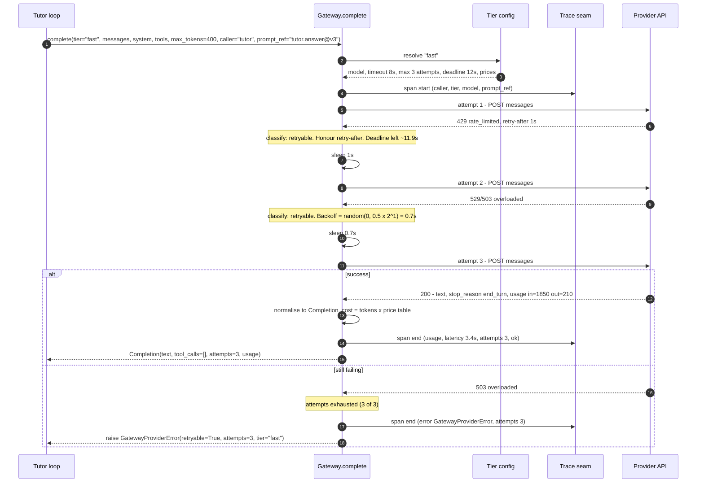

# M01 — How the model gateway works

- Component: `PLAT-02` (Model gateway, tiered routing)
- Part: 1 — How the system is wired
- Depth: deep dive
- Issue: [#2](https://github.com/deekshak012/ai-tutor/issues/2)
- Prereqs: none · Next: [M02 — How tracing & observability work](02-tracing-and-observability.md)

## What you'll understand

How every model call in ai-tutor is made: one internal module, written directly against provider APIs with no agent framework, that picks a model tier for the job, enforces timeouts and retries, turns provider failures into a small set of typed exceptions, and records tokens and cost for every call. By the end you should be able to sketch the gateway's contract on a whiteboard, explain which failures it retries and which it refuses to, and say where its responsibility ends and an agent loop's begins.

---

## What it is & why it exists

The architecture has six model-using components: three agents (Course Planner, Researcher, Tutor) and three workflows (Lesson Builder, Reviewer, Assessor). Every one of them needs to send a prompt to an LLM and get a completion back. The model gateway is the single module that does that sending. Nothing else in the backend is allowed to import a provider SDK or open an HTTP connection to a model provider. You can see it in the data-flow diagram in [docs/architecture/overview.md](../architecture/overview.md): every agent and workflow has an arrow to `GW` (Model Gateway), and only `GW` faces the outside world.

If you've built on ServiceNow, think of it as the equivalent of the platform owning the LLM connection (credentials, the connection/spoke config, throttling, usage metering) so that individual agents and skills never call the provider themselves. The difference here is that **we own that layer**, and we write it by hand. That's the whole point of [ADR 0003](../decisions/0003-no-agent-frameworks-at-first.md).

It exists because six components making model calls on their own would each have to reimplement the same cross-cutting concerns, and each would get them slightly wrong in a different way:

| Concern | Without a gateway | With a gateway |
|---|---|---|
| Which model to use | Model IDs hard-coded in six places. Upgrading a model means a six-file hunt. | Callers ask for a **tier** (`strong` / `mid` / `fast`), and one config maps tiers to models. |
| Failure handling | Each caller catches provider-specific exceptions (`anthropic.RateLimitError`, `openai.APITimeoutError`, ...). | Callers catch a handful of **gateway exceptions** that mean the same thing whatever the provider. |
| Retries and timeouts | Inconsistent, or missing entirely. Sometimes doubled with the SDK's own retries. | One policy, tuned per tier. The live Tutor gets a tight latency budget, background work gets a patient one. |
| Cost visibility | You find out what research cost from the provider invoice at month end. | Every call records input/output tokens and a computed cost, tagged with caller and tier. |
| Tracing | Six different places to add Langfuse instrumentation. | One seam. [PLAT-03](02-tracing-and-observability.md) plugs Langfuse in there and every call is traced. |
| Evals | Hard to replay or stub model calls in tests. | One place to substitute a fake or recorded provider, which matters for the [eval runner](17-eval-runner.md). |

The principle in [CLAUDE.md](../../CLAUDE.md) states it compactly: *"Model tiers match the job. All model calls go through one internal gateway module."* Those two halves depend on each other. Tiering only works if there's one place that resolves a tier to a model, and the single chokepoint is what makes that place exist.

### What the gateway is *not*

This boundary matters as much as anything else in this module, because it's where ADR 0003's learning goal lives.

- **It is not an agent loop.** The gateway does exactly **one round-trip** per call: request in, completion out. If the model replies with a tool call ("search the knowledge store for X"), the gateway hands that tool call back to the caller *as data*. It does not execute the tool, append the result, and call the model again. That loop (decide, act, observe, repeat) belongs to the Tutor, Course Planner, and Researcher, and Deeksha writes it by hand (see [M06](06-course-planner-agent.md), [M07](07-researcher-agent.md), [M13](13-tutor-agent-loop.md)). A gateway that ran tool loops would quietly turn into the agent framework ADR 0003 rejected.
- **It does not assemble context or render prompts.** Building the prompt (the context packet from [ADR 0001](../decisions/0001-agents-share-state-through-database.md)) and filling in any prompt template is the caller's job. The gateway sends what it is given and records the `prompt_ref` label the caller passes.
- **It does not judge the content.** It doesn't validate that a Lesson Builder response is valid slide JSON. That belongs to the workflow's own I/O contract ([io-contracts](../concepts/io-contracts.md)). The gateway's guarantees are about *transport*: the call either returned a well-formed completion or raised a typed error.

So the gateway is deliberately "dumb" about the domain and strict about the mechanics.

---

## How it works, step by step

### The contract

The backlog entry ([PLAT-02 in backlog-draft.md](../backlog/backlog-draft.md)) fixes the behaviour: tiers selectable per call, retries and timeouts, a typed exception on a forced API error, usage recorded per call, a lint/grep check that all calls go through it, and a seam for Langfuse. A contract that meets those requirements looks roughly like this. It's illustrative, not prescribed, and the exact field names are Deeksha's to choose:

```python
from dataclasses import dataclass
from typing import Literal

Tier = Literal["strong", "mid", "fast"]

class TraceContext: ...             # opaque parent-trace handle; its shape is open (M02)

@dataclass(frozen=True)
class Usage:
    input_tokens: int
    output_tokens: int
    cached_input_tokens: int      # 0 if the provider/prompt doesn't use prompt caching
    cost_usd: float               # computed by the gateway from a price table

@dataclass(frozen=True)
class Completion:
    text: str
    tool_calls: list[dict]        # returned to the caller, never executed here
    stop_reason: str              # "end_turn", "max_tokens", "tool_use", ...
    model: str                    # the concrete model the tier resolved to
    tier: Tier
    usage: Usage
    latency_ms: int
    attempts: int                 # 1 = no retries were needed

def complete(
    *,
    tier: Tier,
    messages: list[dict],
    system: str | None = None,
    tools: list[dict] | None = None,
    max_tokens: int,
    caller: str,                  # "tutor", "lesson_builder", ... for usage + traces
    prompt_ref: str | None = None, # prompt name@version, recorded on the trace (M02)
    trace: TraceContext | None = None, # optional parent trace, so calls nest (M02)
) -> Completion: ...

@dataclass(frozen=True)
class Embeddings:
    vectors: list[list[float]]
    model: str
    usage: Usage                  # input tokens only; no output tokens

def embed(
    *,
    texts: list[str],
    caller: str,
    trace: TraceContext | None = None,
) -> Embeddings: ...
```

`messages` and `system` arrive **already rendered**. The gateway never looks up or fills in a prompt template. `prompt_ref` is just a label saying which template and version the caller rendered, and the gateway copies it onto the usage record and the trace. Where the templates themselves live (Langfuse prompt management, or files in git) is an open question in [M02](02-tracing-and-observability.md#open-design-questions). The contract is the same either way, because fetching and filling the template happens in the caller (or a small prompt helper beside it), before `complete(...)` is called.

`trace` is how one agent turn that makes several model calls ends up as one trace with several nested generations in Langfuse, rather than several unrelated traces. Whether it's passed explicitly like this or picked up from request-scoped context is also open. M02 covers the options.

**Embeddings go through the gateway too.** "Every model call" includes turning text into vectors for the knowledge store and retrieval ([pgvector](../concepts/pgvector.md), M03). `embed(...)` isn't tiered like `complete(...)`: there's one configured embedding model, because every vector in an index must come from the same model to be comparable, and switching it means re-embedding everything. It shares the rest of the pipeline (timeouts, retries, typed errors, usage and cost, the trace seam). Which provider and model supplies embeddings is an open question (gap #2 in the [backlog draft](../backlog/backlog-draft.md)).

Three things in that signature are design choices you should be able to defend:

1. **`tier`, not `model`.** Callers express *what kind of job this is*, not which SKU to use. A per-call override to a specific model might be useful for experiments and evals. Whether to allow one is an open choice (see Design decisions).
2. **`caller` is required.** Without it, usage and traces can't be attributed. "We spent $40 yesterday" isn't actionable; "the Researcher spent $31 of it on strong-tier calls it shouldn't have been making" is.
3. **The return type is the gateway's own `Completion`, not the provider's response object.** If the caller got back an `anthropic.types.Message`, provider types would leak into every agent, and switching or adding a provider would touch everything. Normalising at the boundary is what makes the gateway a gateway.

### The call pipeline

Inside `complete(...)`, a call goes through these stages:



Now each stage in detail.

#### 1. Resolve the tier

The gateway looks up the tier in configuration loaded at startup (via the settings module from [PLAT-01 / M03](03-backend-and-data-store.md)). A tier is more than a model name. It's a bundle of policy:

| Tier | Used by (from the [architecture](../architecture/overview.md)) | What the job needs | Policy implications |
|---|---|---|---|
| `strong` | Course Planner, Reviewer | Best reasoning. Planning a whole course, catching subtle factual errors against sources. | Highest price per token. Runs ahead of the learner, so a generous timeout and several retries are fine. |
| `mid` | Researcher, Lesson Builder, Assessor | Good-quality structured output at volume. Many calls per course. | Moderate price. Background work, so moderate timeout and several retries. The Assessor sometimes needs **vision**, so the mid model has to accept images or the tier needs a vision variant. |
| `fast` | Tutor | Low latency. The [product spec](../product-spec.md) targets voice replies starting in about 1–2 s. | Cheapest per token. A **tight** timeout and few retries, because a reply that arrives after 20 s of retrying has already failed the learner. |

See [model tiers](../concepts/model-tiers.md) for the general idea.

> **Open choice: which provider and model per tier.** Nothing in the repo picks concrete models, and nothing should until Deeksha decides. The realistic options:
> - **(a) One provider, three models** (e.g. one vendor's large / medium / small models). The simplest adapter, one SDK, one auth setup, one error taxonomy to map. This is the natural v0.0 start.
> - **(b) Mixed providers per tier** (e.g. strong from vendor A, fast from vendor B because B is faster). This forces you to write a real adapter layer and normalise two message formats, two tool-call formats, and two error taxonomies. It's more to learn, and more to maintain.
> - **(c) Option (a) now, with the internal `Completion` type designed so that (b) is possible later.** The provider-specific code stays behind one adapter interface even while only one adapter exists.
>
> Whatever is chosen, the mapping belongs in **configuration** (env vars or a settings file), not code. Then "upgrade the fast tier" is a config change, and an eval run can compare two mappings. Model routing as an optimisation is explicitly a v2.x concern ([release-plan.md](../release-plan.md): *"model routing, cost optimization"*). v0.0 just needs the seam.

#### 2. Build the provider request

The gateway translates the internal call into the provider's wire format: model ID, `max_tokens`, system prompt, messages, tool definitions, and any provider-specific options. This is the "adapter" half of the [gateway pattern](../concepts/gateway-pattern.md). With one provider it's nearly a pass-through. With several, it's where format differences get absorbed (for example, where the system prompt goes, and how tool schemas and tool results are shaped).

This is a [direct provider API call](../concepts/direct-provider-api-calls.md). "Direct" means the gateway uses the provider's own SDK or raw HTTP, with no orchestration library in between. Using the vendor's thin official SDK still counts as direct. What ADR 0003 rules out is a layer that hides the request and response mechanics (prompt templates, chains, tool-execution loops, memory).

#### 3. Open a trace span (the Langfuse seam)

Before sending, the gateway marks the start of an observable unit of work. In PLAT-02 this seam can be as small as a hook that receives `(caller, tier, model, prompt_ref, trace, start_time)` and later `(usage, latency, attempts, outcome)`. In v0.0 it might do nothing or log. [PLAT-03](02-tracing-and-observability.md) implements it against Langfuse so that every call produces a trace with tier, tokens, cost, latency, and prompt version. That's the subject of M02 ([observability-and-tracing](../concepts/observability-and-tracing.md), [prompt-versioning](../concepts/prompt-versioning.md)).

The design point to take away is that tracing is a **seam on the gateway, not code inside each agent**. Because every call already passes through one function, instrumenting that function instruments the whole system.

#### 4. Send, with a timeout

Every request carries an explicit [timeout](../concepts/timeouts.md). Without one, a hung connection can block a Tutor turn indefinitely, or tie up a background worker. LLM timeouts are trickier than ordinary API timeouts because **latency scales with output length**: a 4,000-token lesson draft legitimately takes much longer than a 50-token Tutor acknowledgement. Tier-level timeouts are therefore a starting point, and the caller may need to scale them with `max_tokens`.

Two gotchas worth knowing:

- **Official provider SDKs usually ship with their own retries and long default timeouts.** The mainstream Python SDKs retry a couple of times by default and use timeouts measured in minutes. If the gateway wraps an SDK and adds its own retry loop without disabling the SDK's, a single logical call can make up to *(gateway attempts × SDK attempts)* HTTP requests. Pick one owner for the retry policy. Since the gateway is where the learning is, the usual choice is to set the SDK's retries to zero and do them in the gateway.
- **A client-side timeout does not cancel server-side work.** If the gateway gives up at 8 s, the provider may still finish generating, and may still bill for it. Timeouts protect the *caller's* latency. They don't save money.

**Streaming** is related. Voice (v0.5) and a responsive chat panel (v0.1) benefit from streaming tokens as they're generated, so the learner sees or hears the start of a reply in about 1 s even if the full reply takes 5 s. With streaming there are two timeouts: time-to-first-token, and the overall or idle timeout. Retrying is also only safe *before* the first token reaches the user. **Open choice:** whether PLAT-02's v0.0 contract includes a `stream(...)` sibling to `complete(...)`, or whether streaming is added when the Tutor needs it (TUT-01 / v0.1 or voice / v0.5). Adding it later is fine as long as both paths share the tier resolution, error mapping, and usage recording.

#### 5. Normalise the response

On success, the provider's response becomes a `Completion`: text, any tool calls (as plain data), the stop reason, the concrete model that served the call, and raw token counts. The stop reason deserves a note. `max_tokens` as a stop reason is **not** an error at the transport level, because the call succeeded. But it usually means truncated output, so callers like the Lesson Builder should treat it as a contract failure. The gateway reports it and the caller decides.

#### 6. Classify errors and retry

This is the heart of "forced error → retry → typed exception". When a call fails, the gateway classifies the failure first:

| Failure | Typical signal | Retry? | Typed exception if it ends here |
|---|---|---|---|
| Rate limited | HTTP 429, often with a `retry-after` header | Yes. Honour `retry-after` if present, else back off | `GatewayRateLimited` |
| Provider overloaded or server error | HTTP 5xx, or a provider-specific "overloaded" status | Yes, with backoff | `GatewayProviderError` |
| Network failure | connection reset, DNS failure, TLS error | Yes, with backoff | `GatewayConnectionError` |
| Timeout | the gateway's own deadline fired | Usually yes, once or twice. Maybe not for `fast` if the latency budget is gone | `GatewayTimeout` |
| Bad request | HTTP 400 / 422: malformed messages, bad tool schema | **No**. The same request will fail the same way | `GatewayBadRequest` |
| Context too long | 400 with a context-length error | **No**. The caller must shrink the context packet | `GatewayContextTooLong` |
| Auth / permission | HTTP 401 / 403 | **No**. Retrying a bad key wastes time and can trip abuse limits | `GatewayAuthError` |
| Model not found | HTTP 404 | **No**. A config bug (the tier points at a non-existent model) | `GatewayConfigError` |

All of them inherit from one base class, so a caller can catch broadly or narrowly:

```python
class GatewayError(Exception):
    retryable: bool = False   # was this kind of failure eligible for retry?
    attempts: int             # how many tries were made before giving up
    tier: str
    caller: str

class GatewayRateLimited(GatewayError): retryable = True
class GatewayTimeout(GatewayError): retryable = True
class GatewayContextTooLong(GatewayError): ...
# ...and so on
```

Why typed exceptions rather than letting provider exceptions through? Callers need to make *decisions*, and different failures call for different ones:

- The **Tutor** catching `GatewayTimeout` or `GatewayRateLimited` might say "give me a moment", then try again on the next turn or degrade gracefully.
- The **Lesson Builder** catching `GatewayContextTooLong` should rebuild a smaller context packet. Retrying the same request will never work.
- **Anything** catching `GatewayAuthError` or `GatewayConfigError` should fail loudly. It's an operator problem, not a transient one.

If provider exceptions leaked through, every caller would need to know every provider's taxonomy.

The retry itself uses [exponential backoff with jitter](../concepts/retries-and-backoff.md): wait roughly `base × 2^attempt`, capped, randomised so that many concurrent callers who failed together don't all retry in the same millisecond. If the provider sends `retry-after`, that wins, because the server is telling you exactly when capacity will be back.

Retries have to respect a **budget**, not just a count. For background tiers, "up to 4 attempts" is fine. For the `fast` tier, the binding limit is wall-clock time. Two different numbers matter here, and it's easy to blur them:

- **The target** is what a good turn feels like: the [product spec](../product-spec.md) wants voice replies to *start* in about 1–2 s, and a typed chat reply should normally arrive in a few seconds. A target is something you measure and tune, not something the gateway enforces.
- **The deadline** is the give-up point: after it, the Tutor stops waiting and shows a fallback message. It has to be longer than the target, or a single slow-but-successful call would be thrown away.

Retries are only worth attempting if they can finish before the deadline. If one attempt already used most of the remaining time, a retry that can't fit is pointless and the gateway should raise immediately. That's why the policy is a per-call **deadline** that retries can't exceed, rather than a bare attempt count. With streaming (voice), the target is judged on time-to-first-token instead, which is one reason streaming matters so much for the live tier.

> **Open choice: fallback.** When the `fast` tier's model is down, should the gateway automatically fall back to a different model or provider? Options:
> - **(a) No automatic fallback.** The gateway raises, and the caller decides (e.g. the Tutor explicitly asks for `mid`). Behaviour stays explicit and evals stay honest.
> - **(b) Configured per-tier fallback model.** Better availability, but the system can silently start running on a different model with different behaviour and cost, which you'd only notice in traces.
> - **(c) No fallback in v0.0, revisit in v2.x with model routing.**
>
> Option (a) or (c) fits "every workflow has a defined input and output so it can be evaluated on its own" best, because a silent model swap changes the thing being evaluated. Either way it's Deeksha's call, not a settled decision.

#### 7. Compute usage and cost

Providers report token counts on every successful response: input tokens, output tokens, and (when prompt caching is used) cached-read and cache-write tokens, which are billed at different rates. The gateway multiplies those counts by a **price table** keyed on model to get `cost_usd`. See [token and cost accounting](../concepts/token-and-cost-accounting.md).

The price table is configuration and goes stale whenever a provider changes prices. Treat it as versioned data with an "effective from" date, not as a constant buried in code. The computed cost is an *estimate* that should match the invoice closely but won't be authoritative.

What about failed attempts? A 429 or a 400 generally isn't billed. A timeout might be, because the server may have finished generating. So the gateway records the **number of attempts** and the **outcome** for every logical call, and records tokens only where the provider reported them.

#### 8. Record usage and close the span

Every logical call, successful or not, ends with a usage record: caller, tier, model, tokens, cost, latency, attempts, outcome, and `prompt_ref`. Where that record lives is an open design question. See the next section.

### Enforcing the chokepoint

A gateway that is merely *conventional* will be bypassed the first time someone is in a hurry. PLAT-02's acceptance criteria require that "every model call in the codebase goes through the gateway (enforced by a lint/grep check)". Two realistic mechanisms:

- **A ruff banned-imports rule.** Ruff's `flake8-tidy-imports` setting `banned-api` can forbid `import anthropic` / `import openai` (and their submodules), with a per-file ignore for the gateway package only. Violations show up in the editor and in the existing post-edit ruff hook (see CLAUDE.md "Hooks"), before CI even runs.
- **A CI grep step.** For example, fail if `anthropic` / `openai` / a provider's hostname appears in any file under `backend/` outside the gateway directory. It's cruder, but it also catches raw HTTP calls to provider URLs, which an import ban misses.

Using both is reasonable. The deeper point is that **architectural rules that aren't machine-checked decay**, and the gateway's whole value depends on it being the *only* path.

---

## Where the data lives

Mostly configuration and telemetry. The gateway itself holds no conversation state (ADR 0001 puts shared state in Postgres, owned by the agents and workflows, not the gateway).

| Data | Where | Notes |
|---|---|---|
| Provider API keys | Environment / secret store, read via settings ([M03](03-backend-and-data-store.md)) | Never in the repo. PLAT-04 handles production secret management. |
| Tier → model mapping, per-tier timeout and retry policy | Configuration (settings / env) | Changing a model is a config change, so it can be evaluated before and after. |
| Price table (model → per-token prices, effective date) | Configuration, or a small versioned data file | Goes stale. Needs an owner and a date. |
| Per-call usage record | **Open choice**, see below | Required by the acceptance criteria ("usage is recorded per call"). |
| Traces (prompt, completion, tokens, latency, prompt version) | Langfuse, from PLAT-03 ([M02](02-tracing-and-observability.md)) | The rich, inspectable record of each call. |

> **Open choice: where per-call usage is stored.**
> - **(a) Langfuse only.** Langfuse traces already carry tokens, cost, and latency, so nothing new goes in Postgres. Simplest. The downside is that the app can't easily *query* its own spend (e.g. "stop background research for this course once it has cost $2") without calling the Langfuse API, and usage data depends on an external tool being up.
> - **(b) A Postgres `model_calls` table, plus Langfuse.** The app owns a compact, queryable ledger (who, which tier, how many tokens, cost, outcome) and Langfuse owns the rich trace. This enables in-app budgets and cost dashboards with a SQL query. The cost is a write on every model call and one more table to maintain.
> - **(c) Structured logs only in v0.0, and pick (a) or (b) once there's a real consumer.** Defensible as a minimal start, but it arguably under-delivers on "usage is recorded per call".
>
> The product doesn't yet require in-app budgets, which favours (a) or (c) for v0.0. Course-level cost caps and the v2.x "cost optimization" work would favour (b). If (b) is chosen, the table belongs in [docs/data/guide.md](../data/guide.md). Until then, no gateway table exists.

---

## Key concepts

- [Direct provider API calls](../concepts/direct-provider-api-calls.md): calling the vendor's API (via its thin SDK or raw HTTP) with no orchestration framework in between, so you see the exact request and response.
- [Model tiers](../concepts/model-tiers.md): naming jobs by capability, latency, and cost class (`strong` / `mid` / `fast`) instead of by model SKU, so the mapping can change in one place.
- [Retries and backoff](../concepts/retries-and-backoff.md): which failures are worth retrying, how long to wait (exponential, jittered, honouring `retry-after`), and when to give up.
- [Timeouts](../concepts/timeouts.md): explicit deadlines on every call, sized to output length and to who's waiting (a live learner versus a background job).
- [Token and cost accounting](../concepts/token-and-cost-accounting.md): turning per-response token counts into per-call cost, attributed to a caller and a tier.
- [Gateway pattern](../concepts/gateway-pattern.md): one object that wraps an external system behind an interface the application owns, the single chokepoint idea.
- Linked, owned by other modules: [observability and tracing](../concepts/observability-and-tracing.md) (the Langfuse seam, M02), [prompt versioning](../concepts/prompt-versioning.md) (`prompt_ref`), [offline evals](../concepts/offline-evals.md) (the PLAT-02 smoke eval and the eval runner), [I/O contracts](../concepts/io-contracts.md) (why the gateway's own contract must be explicit).

---

## Design decisions & rejected alternatives

### Settled: no agent framework at first ([ADR 0003](../decisions/0003-no-agent-frameworks-at-first.md))

**Decision.** All model calls go through one hand-written gateway against provider APIs. No LangChain, LlamaIndex, or agent SDK for the agent loops in the initial releases.

**Why.** Frameworks hide exactly the mechanics this project exists to teach: the tool-call loop, context assembly, and retries. A framework's "agent executor" would own the loop and its retry policy would own failure handling, and you'd learn the framework's model of an agent instead of agents. ADR 0003 accepts the trade-off directly: "more code to write and maintain early on; slower initial velocity in exchange for deeper understanding". It's also revisitable *per component* in v2.x, so this isn't a permanent stance.

**What this means for the gateway's scope.** Because the agent loops are hand-written, the gateway must stay a *single round-trip* primitive (see "What the gateway is not"). If it grew tool execution, memory, or automatic multi-step behaviour, it would become a home-made framework and undo the ADR.

**Rejected: a provider-abstraction library** (a "call any model with one API" router). It isn't an agent framework, so ADR 0003 doesn't strictly forbid it, but it removes the adapter and error-normalisation work that is part of what PLAT-02 teaches. CLAUDE.md also says not to add a library for something one file already does. Worth reconsidering only if (b) "mixed providers per tier" is chosen and the adapter work stops being educational.

### Settled: a single chokepoint for all model calls

**Decision.** Every model call, from every agent and workflow, goes through the gateway. A lint/grep check enforces this.

**Why.** Each cross-cutting concern (tier selection, retries, timeouts, error typing, cost, tracing, test stubbing) is implemented once and is then automatically true *everywhere*. This is what lets PLAT-03 add tracing to the whole system by touching one module, and lets the [eval runner (M17)](17-eval-runner.md) reason about cost and substitute providers.

**Rejected: per-agent clients.** Each agent owns its own provider client, configured for its needs. It looks more flexible, but it produces six retry policies, six error-handling styles, no unified cost view, and six places to add tracing. The flexibility it seems to buy (different policy per caller) is already available through per-tier policy and per-call parameters.

**Rejected: a separate gateway *service*** (a network proxy in front of the providers). Useful at organisational scale, when many apps share keys, quotas, and audit. For one backend it adds a network hop (bad for the Tutor's latency budget) and a deployment unit, with no benefit an in-process module doesn't already give. In-process module first. Extracting it later is easy *because* there's one chokepoint.

### Settled by principle: tiers match the job

From the [architecture principles](../architecture/overview.md): Course Planner and Reviewer get `strong`, Researcher, Lesson Builder, and Assessor get `mid`, and Tutor gets `fast`. The reasoning comes from the "expensive work happens ahead of the learner" principle. The components that run in the background can afford slow, expensive, high-quality models. The one component that runs live (the Tutor) is optimised for latency, and it compensates for a smaller model by leaning on lessons and knowledge-store content that stronger models prepared earlier.

### Open (summarised from above)

| Question | Options | Where discussed |
|---|---|---|
| Provider and model per tier | one provider / mixed / one now with an adapter-ready design | Stage 1 |
| Streaming in the v0.0 contract | now / when TUT-01 or voice needs it | Stage 4 |
| Automatic fallback model | none / per-tier configured / defer to v2.x routing | Stage 6 |
| Where usage is stored | Langfuse only / Postgres `model_calls` + Langfuse / logs first | Where the data lives |
| Per-call model override (bypass the tier) | allow for evals and experiments / forbid | Stage 1 note |
| Who owns retries | gateway (SDK retries off) / delegate to SDK | Stage 4 |
| Embeddings provider and model | same provider as completions / a dedicated embeddings provider | The contract |
| Where prompt templates live | Langfuse prompt management / files in git | The contract, [M02](02-tracing-and-observability.md#open-design-questions) |
| How trace context reaches the gateway | explicit `trace` argument / request-scoped context | The contract, M02 |

---

## A worked example

**Scenario.** A learner is in a v0.1 lesson on hypothesis testing (one of the proposed [QA-02 test courses](../backlog/backlog-draft.md)) and types into the chat panel: *"Why do we fail to reject the null instead of accepting it?"* The Tutor's hand-written loop has already assembled a context packet (current slide, lesson concepts, a few knowledge-store items) and now needs one model completion.

For concreteness, assume this illustrative `fast`-tier policy for the **typed chat panel** (non-streaming, v0.1). These numbers are examples, not decisions: per-attempt timeout 8 s, max 3 attempts, overall deadline 12 s, backoff base 0.5 s with full jitter, cap 4 s. The 12 s deadline is the give-up ceiling from Stage 6, not the target: on a healthy call the reply arrives in a second or two, and this example deliberately shows the bad path. A voice turn would use streaming with a much tighter time-to-first-token deadline.

### Step by step



1. **Caller.** The Tutor calls `complete(tier="fast", ...)`. It passes `caller="tutor"` and a `prompt_ref` so the call can be attributed and traced. It does **not** pass a model name. It also passes `tools` (say, `search_knowledge_store`). The gateway forwards those definitions but will never run them.
2. **Tier selection.** The gateway resolves `fast` from configuration to a concrete model ID plus the fast-tier policy. If the config pointed at a model that doesn't exist, the first attempt would return 404 and the gateway would raise `GatewayConfigError` immediately, with no retries, because retrying a config bug is pointless.
3. **Span opened.** The trace seam records the start. In v0.0 that might be a structured log line. After PLAT-03 it becomes a Langfuse span.
4. **Attempt 1 → 429.** The provider rate-limits the request and includes `retry-after: 1`. The gateway classifies this as retryable, checks the remaining deadline (about 11.9 s, which is plenty), and sleeps exactly 1 s rather than computing its own backoff, because the server knows best.
5. **Attempt 2 → overloaded.** There's no `retry-after` this time, so the gateway uses exponential backoff with full jitter: a random wait between 0 and `0.5 × 2^1 = 1.0` s, here 0.7 s. The jitter matters. If 200 Tutor sessions hit the same overload, un-jittered retries would arrive as a synchronised second wave and make the overload worse.
6. **Attempt 3, success path.** The provider returns 200 with the answer, `stop_reason=end_turn`, and usage of 1,850 input and 210 output tokens. The gateway builds a `Completion`, multiplies the tokens by the fast model's per-token prices to get `cost_usd`, records usage, closes the span (latency about 3.4 s, `attempts=3`), and returns. The Tutor sees a normal completion. It *can* see `attempts=3` and could log it, but it doesn't need to care. If the completion had contained a tool call instead of text, the Tutor's loop, not the gateway, would run the knowledge-store search and call `complete(...)` again.
7. **Attempt 3, failure path (the forced error).** Suppose the provider is still overloaded. Three of three attempts are used up, so the gateway closes the span with the error and raises `GatewayProviderError(retryable=True, attempts=3, tier="fast", caller="tutor")`. Nothing provider-specific escapes. The Tutor catches it and does something learner-appropriate: a short "I'm having trouble reaching my brain for a second, try again?" message, with the turn left resumable. It doesn't crash the chat or retry silently for another 30 s.

### The forced-error variants you should be able to predict

PLAT-02's acceptance criterion "a forced API error surfaces a typed exception" is typically tested by pointing the gateway at a fake provider that returns a chosen error. Work out what happens for each before reading the answer:

| Forced error | Attempts made | Exception | Why |
|---|---|---|---|
| 401 (bad API key) | 1 | `GatewayAuthError` | Not transient. Retrying can't fix a credential. |
| 400 context length exceeded | 1 | `GatewayContextTooLong` | Same input, same failure. The caller must shrink the packet. |
| 429 three times | 3 | `GatewayRateLimited` | Retryable, but the budget ran out. |
| Every attempt hangs past 8 s | 1 (2nd would breach the 12 s deadline) | `GatewayTimeout` | 8 s used, and a second 8 s attempt can't fit in the remaining 4 s, so stop. |
| 503, then 200 | 2 | none, returns `Completion(attempts=2)` | A transient failure absorbed invisibly. This is the gateway doing its job. |

That fourth row is the one that shows understanding. The *deadline*, not the attempt count, stopped the retries.

### The same call from a background workflow

Run the identical failure sequence through the **Lesson Builder** on the `mid` tier, with a patient policy (say a 60 s timeout, 5 attempts, a 5-minute deadline). The gateway would keep retrying through several minutes of overload, and that's correct. No learner is waiting, because the lesson is being built ahead of time. Same code path, different tier policy, different right answer. That's what "model tiers match the job" means in practice. The tier carries a latency budget as well as a model.

---

## Check your understanding

1. The Tutor's model returns a response whose `stop_reason` is `tool_use`, asking to call `search_knowledge_store`. Walk through what the gateway does with it, and what it deliberately does *not* do. Which ADR would be violated if it did more?
2. Why is `GatewayContextTooLong` non-retryable while `GatewayTimeout` usually is? What should each caller (Tutor and Lesson Builder) do differently when they catch each one?
3. The gateway wraps an official provider SDK that retries twice by default, and the gateway's own policy is 3 attempts. In the worst case, how many HTTP requests does one `complete(...)` call make? What would you change, and why does it matter more for the `fast` tier?
4. Give one argument for storing per-call usage in a Postgres table and one for keeping it only in Langfuse. Which product feature, if it were on the roadmap tomorrow, would settle the question?
5. A teammate adds a "quick" script under `backend/` that imports a provider SDK directly to bulk-summarise sources. Which two things in the system catch this, and what concrete capabilities does that script lose by bypassing the gateway?

### Thought experiment (no coding)

Imagine the `fast` tier's provider has a 20-minute partial outage during an evening study session, with roughly half of requests returning "overloaded". At the same time the Researcher is pre-fetching material for tomorrow's lessons on the `mid` tier, from the same provider and on the same API key.

- How does each tier's policy (timeout, attempts, deadline, jitter) shape what the learner experiences versus what the Researcher experiences?
- Rate limits are often per key or per organisation. In what way could the Researcher's patient retries *hurt* the Tutor, and what could the gateway do about it? (Hint: think about whether background tiers should yield capacity to the live tier, and whether that's the gateway's decision or a configuration of it.)
- If you had chosen "automatic per-tier fallback to another provider", what would the learner experience? What would quietly change in your traces and your eval baselines?

Sketch your answers in your own words. If you can explain the trade-offs without referring back to this doc, you understand the gateway.
