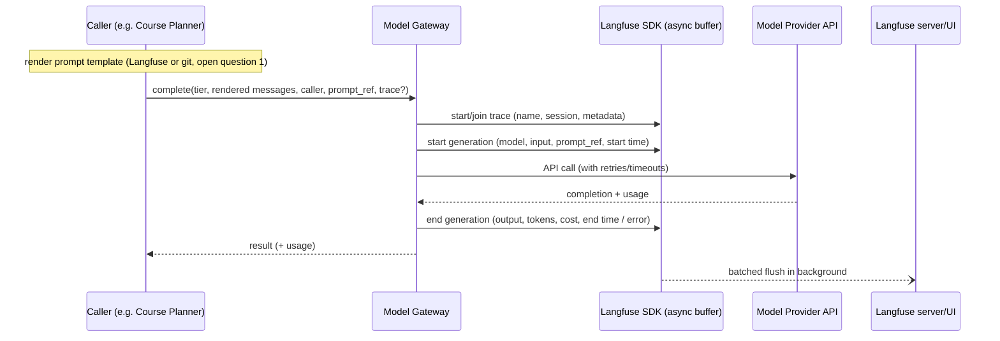

# M02 — How tracing & observability work

- Component: `PLAT-03` (Langfuse tracing wired into the gateway)
- Part: Part 1 — How the system is wired
- Depth: light
- Issue: [#3](https://github.com/deekshak012/ai-tutor/issues/3)
- Prereqs: [M01 — How the model gateway works](01-model-gateway.md) · Next: [M03 — How the backend & data store are assembled](03-backend-and-data-store.md)

## What you'll understand

How you can see after the fact what the system did. Every model call is recorded in Langfuse along with the prompt version it used, its model tier, its token counts, its cost and its latency. By the end you should be able to open one trace and say what each field means and where it came from.

## What it is & why it exists

ai-tutor does most of its expensive work ahead of time, where the learner can't see it. The Course Planner, Researcher, Lesson Builder and Reviewer all run in the background ([architecture overview](../architecture/overview.md)). Only the Tutor runs live. Suppose a lesson comes out wrong, a course costs too much, or the Tutor responds slowly. Without tracing, the only evidence you have is the finished rows in Postgres. Those rows record **what** was produced. They don't record **how** it was produced: which prompt ran, which model, how many tokens, how long it took, or what the model actually returned.

Tracing fills that gap. **Observability** is the ability to answer questions about a running system from what it emits, without adding new code each time you have a question. A **trace** is one unit of work recorded as a tree of timed steps. The project's tracing tool is Langfuse (see the tech stack in `CLAUDE.md`), and Langfuse also handles prompt versioning and evals.

You've probably seen something similar on ServiceNow, in the execution logs of a flow or an agent run. Those logs show you, step by step, what an automation did. Langfuse does the same thing for LLM calls, and it adds token, cost and prompt-version data to each step.

PLAT-03 has a deliberately small scope ([backlog-draft](../backlog/backlog-draft.md)): *every gateway call emits a Langfuse trace/span with prompt version, tier, tokens, cost, and latency.* It is a cross-cutting piece, and two later pieces depend on it:

- **Evals** (QA-01, [M17](17-eval-runner.md)). The eval runner records its scores against traces in Langfuse.
- **Optimization** (OPT-01/02). "Did routing cut cost without hurting quality?" can only be answered with per-call cost and tier data, and that data comes from traces.

## How it works, step by step

Tracing sits inside the gateway from [M01](01-model-gateway.md), at the one point every model call already passes through.

1. **The caller renders its prompt.** Before calling the gateway, the caller (or a small prompt helper beside it) gets the prompt template by name, at a pinned version or a label such as `production`, and fills in the variables. Under the Langfuse-managed option the template comes from Langfuse prompt management (usually cached locally). Under the git option it comes from a file in the repo. Either way the result is the same: rendered `system` and `messages`, plus a `prompt_ref` label such as `course_planner.draft_outline@7`. Where templates live is open question 1 below.
2. **The caller asks the gateway for a completion.** It passes exactly M01's contract: a tier (`strong` / `mid` / `fast`), the rendered messages, `caller`, `prompt_ref`, and optionally `trace`, the parent trace context. Context labels such as `course_id` or a session id travel with the trace context. The gateway never looks up or fills in a prompt itself.
3. **The gateway opens or joins a trace.** If `trace` points to an existing trace, the gateway adds to it. An example is an agent loop making its third model call, which belongs in the same trace as the first two. Otherwise the gateway starts a new trace. The trace gets a name (for example `course_planner.plan`) and metadata. How trace context reaches the gateway is open question 3.
4. **The gateway starts a *generation* observation.** A generation is Langfuse's observation type for one LLM call. The gateway records the start time, the model, the model parameters, the input messages, and `prompt_ref`. Under the Langfuse-managed option it can also link the generation to that prompt version in Langfuse, so the UI can jump from the trace to the prompt.
5. **The gateway calls the provider.** This is the direct API call from M01, with its retries and timeouts. Each retry can be recorded as its own child observation or event, so the trace shows that the first attempt hit a rate limit.
6. **The gateway closes the generation.** It records the end time (latency is end minus start), the output, the usage numbers (input and output tokens) and the cost. Cost is either calculated by the gateway from a price table, which M01's token-and-cost capture already does, or worked out by Langfuse from the model name and its own price definitions. The open questions below cover which one should be the source of truth. On an error the generation is marked as failed and the error message is stored.
7. **The trace is sent asynchronously.** The Langfuse SDK batches events and sends them in the background. Tracing never blocks the model call, and if Langfuse is down the call still succeeds.
8. **You read it in the Langfuse UI.** You can filter traces by name, tag, user or session, open one, and see the tree of observations with timings, tokens and cost.



The important detail in this diagram is that the caller never writes trace data itself. It hands over rendered messages, a `prompt_ref` label and optional trace context, and the gateway records everything else. The only Langfuse read a caller might make is fetching a prompt template, and only under the Langfuse-managed option.

## Where the data lives

**Trace data lives in Langfuse, not Postgres.** No ai-tutor table is added or changed by PLAT-03. The Langfuse server, either self-hosted in Docker or Langfuse Cloud (still to be decided), stores traces, observations, sessions, scores and prompt versions in its own storage.

| Store | What's there | Owned by |
|---|---|---|
| Langfuse traces | One per unit of work: name, timestamps, session id, user id, tags, metadata | Langfuse |
| Langfuse observations | Spans, generations and events nested under a trace. Generations carry model, input/output, usage, cost, latency and the prompt link | Langfuse |
| Langfuse prompt management | Named prompts with numbered versions and labels (for example `production`) | Langfuse |
| Postgres ([data guide](../data/guide.md)) | Nothing from tracing. It may hold a `trace_id` reference on rows a traced call produced (a proposal, see the open questions) | ai-tutor |

The split keeps Postgres for **product state**, which agents share under [ADR 0001](../decisions/0001-agents-share-state-through-database.md). Langfuse holds **operational history**. No agent ever reads a trace to decide what to do next. Traces exist for humans and evals.

## Key concepts

- [Observability and tracing](../concepts/observability-and-tracing.md): understanding a system from what it emits, with traces as the main record for LLM apps.
- [Spans](../concepts/spans.md): timed, nested steps inside a trace. In Langfuse, generations are the kind of span used for LLM calls.
- [Prompt versioning](../concepts/prompt-versioning.md): prompts are treated as versioned artifacts, and each trace records which version produced its output.
- [Token and cost accounting](../concepts/token-and-cost-accounting.md): how usage is counted and turned into money.
- [Model tiers](../concepts/model-tiers.md): strong, mid and fast. The tier is recorded on every generation.
- [Gateway pattern](../concepts/gateway-pattern.md): the single seam that makes "trace everything" possible.
- [Offline evals](../concepts/offline-evals.md): the eval scores that will attach to these traces.

## Design decisions & rejected alternatives

**Decision: tracing goes in the gateway, not in each caller.**

- *Why:* every model call already passes through the gateway, because that rule is already enforced by a lint/grep check (PLAT-02). Putting tracing there gives complete coverage for free. A new agent added in v0.4 gets traced on its first call without anyone remembering to add it. Tier, model, tokens, cost and latency are all known in exactly one place, which is the gateway, so that is the only place they can be recorded accurately.
- *Rejected: each caller does its own tracing.* Coverage would depend on every author remembering to do it. Field names would drift between components (one uses `tokens_in`, another uses `prompt_tokens`). The tracing code would also be repeated across six components, which goes against the "one gateway module" rule.
- *Rejected: framework auto-instrumentation* (for example a LangChain callback handler). [ADR 0003](../decisions/0003-no-agent-frameworks-at-first.md) rules out the framework. It also hides the exact mechanics this project wants you to understand.
- *Rejected: logging to Postgres tables only.* That route works, but you would have to build your own tree view, cost roll-ups, prompt-version linking and eval-score attachment. Langfuse already provides these, and it's the stack choice in `CLAUDE.md`.

**What the gateway can't know on its own:** the gateway sees one call at a time, but an agent loop is many calls. To group them under one trace, the caller has to pass context down, such as a trace id or a "current trace" held in request-scoped context. So the caller still supplies **labels** while the gateway does the **recording**. The rule is that callers never touch Langfuse directly.

**Decision: tracing is non-blocking and fail-open.** If tracing fails, the error is logged and the call continues. Observability must never take the product down, and that matters most for the live Tutor.

## A worked example

> **Illustrative only.** No code or real Langfuse instance exists for this project. The structure below follows Langfuse's data model (trace → observations, with generations carrying usage, cost and a prompt link), but the field layout is simplified and every value is invented.

Scenario: a learner creates the course *Intro Statistics for a data analyst* (one of the proposed QA-02 test courses). The Course Planner, on the strong tier, makes one gateway call to draft the outline.

```text
TRACE  course_planner.plan                         id: tr_7f3a…  
  session_id:  course-creation:crs_0192            user_id: learner_04
  tags:        [course_planner, v0.1]
  metadata:    { course_id: crs_0192, component: course_planner }
  start → end: 10:42:03.118 → 10:42:21.904   (18.79 s)
  total cost:  $0.0912

  └─ GENERATION  gateway.complete                  id: obs_c21e…
       model:          <strong-tier model id>       metadata.tier: strong
       model params:   { temperature: 0.4, max_tokens: 4000 }
       prompt:         course_planner.draft_outline   version: 7  (label: production)
       input:          [system: "...", user: "Goal: ... Context: ..."]
       output:         { "modules": [ ... ] }
       usage:          input 2,840 tokens · output 3,115 tokens · total 5,955
       cost:           $0.0912  (input $0.0142 + output $0.0770)
       latency:        18.71 s     (time to first token: 1.32 s)
       level / status: DEFAULT (success)

       └─ EVENT  retry   attempt 1 → 429 rate-limited, backoff 0.8 s
```

Reading it field by field:

| Field | What it tells you | Who supplied it |
|---|---|---|
| Trace name `course_planner.plan` | Which unit of work this is. It's what you filter on. | Caller label, set by the gateway |
| `session_id` | Groups every trace from this one course-creation flow. Langfuse **sessions** are made of traces that share a session id. | Caller label |
| `user_id`, tags, metadata | Filtering and grouping, for example "all strong-tier calls for course X" | Caller labels and gateway |
| Generation | The LLM call itself, which is the observation type that carries model, usage and cost | Gateway |
| `model`, `metadata.tier` | The exact model, plus which tier routed to it. The tier name stays the same even when the model behind a tier changes. | Gateway (M01 tier routing) |
| `prompt` name + version | Which prompt text produced this output. If quality changes between v6 and v7, this field is how you see it. | Caller's `prompt_ref`, recorded by the gateway |
| Usage (input/output tokens) | Token counts reported by the provider | Provider response, recorded by the gateway |
| Cost | Usage multiplied by price. The trace cost is the sum over its generations. | Gateway's price table or Langfuse's model prices (open question) |
| Latency / time to first token | Total wall-clock time, and how long before the first token arrived (relevant for streaming, and very important for the Tutor) | Start and end timestamps |
| Retry event | The first attempt failed with a 429 and the gateway backed off. That accounts for part of the 18.79 s. | Gateway retry logic |

What the trace shows: this outline cost about 9 cents and took about 19 s. Some of that time came from a rate-limit retry, so it wasn't all model time. It was produced by `draft_outline` v7. Once QA-01 attaches an eval score to this trace, you'll also know whether v7 is actually better than v6.

## Open design questions

These are flagged here for planning. None of them is settled.

1. **Langfuse prompt management vs prompts in the repo.** The two options are fetching prompts from Langfuse at runtime, or keeping them as files in git and recording a version or hash on the trace. Langfuse management lets you edit prompts without a deploy. Git keeps prompts reviewable in PRs.
2. **The source of truth for cost.** It could be the gateway's own price table (from M01) or Langfuse's model price definitions. If both are kept, they can drift apart.
3. **How trace context reaches the gateway.** The options are an explicit `trace` argument (as sketched in M01's contract) or an implicit request-scoped context. Multi-call agent loops such as the Tutor and Researcher need this.
4. **Should Postgres rows store a `trace_id`?** For example on a lesson or course plan, so you can go from a bad lesson straight to the calls that produced it.
5. **Learner data in traces.** Inputs and outputs can contain learner messages or homework. Masking, retention and the choice between self-hosted and cloud all need a decision.
6. **Sampling.** Tracing 100% of calls is fine at v0.x scale. Whether the live Tutor should ever be sampled can be decided later.

## Check your understanding

1. Why does putting tracing in the gateway guarantee coverage, when tracing in each caller doesn't? What PLAT-02 rule does this depend on?
2. What is the difference between a trace, a span, a generation and a session? Which of them carries token usage and cost?
3. A lesson's quality dropped last Tuesday. Which trace field would tell you whether a prompt change caused it, and what would you compare?
4. The gateway can't group an agent's five calls into one trace by itself. What extra input does it need from the caller?
5. Why is trace data kept in Langfuse rather than Postgres, and why doesn't this break ADR 0001's "share state through the database" rule?

**Thought experiment (no coding):** Langfuse goes down for an hour while a learner is chatting with the Tutor. Walk through steps 4–7 above. What should the learner experience? What is lost, and what would you want logged? Then flip it around: what would change if tracing were *synchronous*, so each call waited for Langfuse to confirm before returning?
