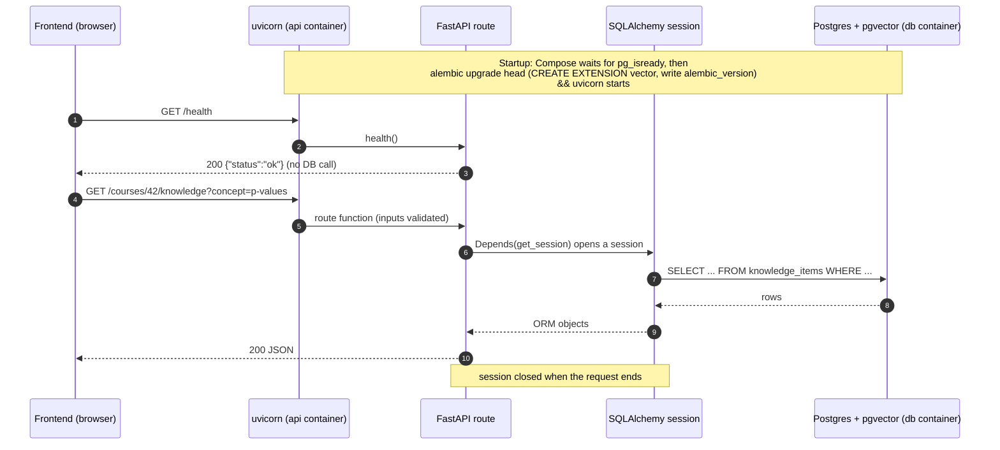

# M03 — How the backend & data store are assembled

- Component: `PLAT-01` (Backend skeleton + Postgres/pgvector + Docker)
- Part: 1 — How the system is wired
- Depth: light
- Issue: [#1](https://github.com/deekshak012/ai-tutor/issues/1)
- Prereqs: none. In reading order it comes after [M01 — model gateway](01-model-gateway.md) and [M02 — tracing & observability](02-tracing-and-observability.md), but it doesn't depend on them. · Next: [M04 — frontend shell](04-frontend-shell.md)

> **Read-to-understand note.** Nothing in this repo is built. The snippets below show how a substrate like this is usually put together. They're illustrations to read, not commands to run here.

## What you'll understand

How the backend process, the database, and the schema history fit together: where a request goes when it arrives, where every piece of state lives, and why one Postgres database with pgvector is enough for both ordinary records and vector search.

## What it is & why it exists

Everything else in ai-tutor sits on three pieces of plumbing:

1. **A FastAPI app.** A Python web process that turns HTTP requests from the frontend into function calls, then sends back JSON.
2. **One Postgres database with the pgvector extension.** This is where all shared state lives: course plans, lessons, knowledge store entries with their embeddings, and the learner model.
3. **Migrations and containers.** Migrations are versioned scripts that grow the schema one step at a time. Docker Compose starts the API and the database the same way on every machine.

Why this has to come first: [ADR 0001](../decisions/0001-agents-share-state-through-database.md) says agents and workflows never pass conversations to each other. The Researcher writes to the database, the Lesson Builder reads from it later, and the Tutor reads what was built ahead of time. So the database isn't just storage. It's the only way components communicate. And because the knowledge store needs similarity search ("find material close in meaning to this question"), that database has to store vectors as well.

The substrate itself has very little logic. It holds no application tables and makes no model calls. Its job is to give every later component a known place to stand.

## How it works, step by step

Two moments matter: **starting the stack**, and **serving a request** once it's running.

### Starting the stack

1. `docker compose up` starts two containers: `db` (image `pgvector/pgvector:pg16`, which is stock Postgres 16 with the pgvector files pre-installed) and `api` (a Python image with the app installed).
2. Compose holds `api` back until `db` passes its healthcheck (`pg_isready`), meaning Postgres actually accepts connections and hasn't merely started. See [health checks](../concepts/health-checks.md).
3. The `api` container's start command is "run migrations, *then* start the server":
   ```dockerfile
   CMD alembic upgrade head && uvicorn app.main:app --host 0.0.0.0 --port 8000
   ```
   Alembic reads the database's `alembic_version` table, sees which migration scripts haven't been applied, and runs them. The very first one does just one thing:
   ```python
   def upgrade() -> None:
       op.execute("CREATE EXTENSION IF NOT EXISTS vector")
   ```
   Because of `&&`, if a migration fails the server never starts, so you can't end up with an API running against a half-migrated schema.
4. uvicorn imports the FastAPI `app` object and starts listening on port 8000.

### Serving a request

1. The frontend sends HTTP to `localhost:8000`.
2. uvicorn hands the request to FastAPI, which matches the path to a route function and validates the inputs against the function's type hints.
3. If the route needs the database, it gets a **session** (a unit of work on a pooled connection) through FastAPI's dependency injection, runs SQL through SQLAlchemy, and the session is closed when the request ends.
4. The route returns a dict or a Pydantic model, and FastAPI serializes it to JSON.

Configuration (chiefly `DATABASE_URL`) comes from environment variables, read once into a typed settings object. The app and the migration tool both read that same setting, so they can't point at different databases.



Where this sits in the bigger picture: in the [architecture overview](../architecture/overview.md) diagram, this module is the `DB` node (Postgres + pgvector) plus the process that hosts the agents and workflows. Every arrow into `DB` in that diagram goes through the session pattern described above.

## Where the data lives

At this layer there are **no application tables**. After migrations run, the database contains only:

- **Extension `vector`** (pgvector). It adds the `vector(n)` column type, the distance operators (`<->` L2, `<=>` cosine, `<#>` negative inner product), and the HNSW and IVFFlat index types. Nothing uses it yet.
- **Table `alembic_version`**, owned by Alembic. It has one column (`version_num`) and one row: the revision the database is currently at.

The database files live in a named Docker volume (`pgdata`), so they survive `docker compose down`. Only `down -v` wipes them.

Later modules add the real tables (courses, knowledge store, lessons, learner model) as new migrations on top of this first one. The canonical list of tables is [docs/data/guide.md](../data/guide.md).

## Key concepts

- [FastAPI app structure](../concepts/fastapi-app-structure.md): the app object, routes, uvicorn, `def` vs `async def`, settings, and per-request DB sessions.
- [Postgres as the single store](../concepts/postgres-as-single-store.md): why one database holds relational state, shared agent state, *and* vectors.
- [pgvector](../concepts/pgvector.md): the extension that adds vector columns and similarity search, and why the knowledge store needs it.
- [Database migrations](../concepts/database-migrations.md): versioned, ordered, reversible schema changes, plus the `alembic_version` table.
- [Containerized local dev](../concepts/containerized-local-dev.md): images, Compose services, service-name DNS, volumes, startup ordering.
- [Health checks](../concepts/health-checks.md): liveness vs readiness, and why `/health` doesn't touch the database.

Related, covered in other modules: the [gateway pattern](../concepts/gateway-pattern.md) (the database stores embeddings, but the gateway's `embed(...)` call, described in [M01](01-model-gateway.md), is what *produces* them) and [observability and tracing](../concepts/observability-and-tracing.md).

## Design decisions & rejected alternatives

| Decision | Chosen | Rejected | Why |
|---|---|---|---|
| Where vectors live | pgvector inside the same Postgres | A separate vector DB (Pinecone, Qdrant, Weaviate, Chroma) | The knowledge store row *is* the cache entry: content, concept tags, source type, verification status, date gathered, and embedding all sit in one row. A single SQL query can combine "nearest in meaning" with "for this course, verified, not yet taught". With two stores you'd have to keep IDs in sync, write twice, and filter in application code. See [Postgres as the single store](../concepts/postgres-as-single-store.md). |
| Shared state | One database every agent and workflow reads and writes | Passing conversation transcripts between agents | [ADR 0001](../decisions/0001-agents-share-state-through-database.md): state you can inspect, components that are decoupled in time, and an input/output contract per workflow that can be evaluated on its own. |
| "Knowledge store doubles as cache" | The store itself is the cache: look it up before you research | A separate cache layer (Redis, in-memory) | Researched material has to be kept anyway, with provenance. Checking it before calling the Researcher again saves model and web cost, and you don't need a second system with its own invalidation rules. |
| Local environment | Docker Compose with `pgvector/pgvector:pg16` | Installing Postgres + pgvector by hand on macOS | You need a specific major version with an extension compiled for it. By hand that's fiddly and drifts between machines. The same image runs on a laptop and in CI. |
| Schema changes | Alembic migrations | `Base.metadata.create_all()`, or ad-hoc SQL | `create_all` only creates tables that are missing. It can't alter a table that already exists, and it keeps no history. Migrations give an ordered, reversible chain and a recorded position for each database. |
| `/health` | Liveness only, no DB call | A health check that runs `SELECT 1` | If liveness depended on the DB, a brief DB outage would make an orchestrator restart every healthy API instance. Dependency checks belong in a separate readiness probe. |
| When migrations run | On container start (`alembic upgrade head && uvicorn`) | A separate deploy step | One command gives you a fully migrated local stack. In production, several replicas migrating at once can race each other, so PLAT-04 (deployment) would move migrations into a deploy step. |
| Course-first data | Schema doesn't require uploaded sources | Source-required model | [ADR 0002](../decisions/0002-course-first-with-optional-sources.md): a course can run with zero uploads. So knowledge rows have to handle `source_type` = web or model-generated, not only uploaded files. |

## A worked example

**Scenario:** a learner is in the *Intro Statistics* course (id 42), and the frontend asks for stored knowledge about "p-values" so it can show related material.

**1. HTTP.** The browser sends `GET http://localhost:8000/courses/42/knowledge?concept=p-values`. Compose publishes the `api` container's port 8000 to the laptop, so the request reaches uvicorn inside the container.

**2. FastAPI route.** FastAPI matches the path and validates `course_id` as an `int`. A route like this would be written roughly as follows (illustrative only):

```python
@router.get("/courses/{course_id}/knowledge")
def list_knowledge(course_id: int, concept: str,
                   session: Session = Depends(get_session)) -> list[KnowledgeOut]:
    rows = session.scalars(
        select(KnowledgeItem)
        .where(KnowledgeItem.course_id == course_id,
               KnowledgeItem.concept_tags.contains([concept]))
    ).all()
    return rows
```

`Depends(get_session)` opens a SQLAlchemy session from the shared connection pool for this request only, and closes it afterwards. The function is a plain `def`, so FastAPI runs it in a threadpool and the blocking DB call doesn't stall other requests.

**3. Database.** The session connects to `db:5432`. Inside the Compose network, the service name `db` is the hostname; `localhost` would mean the API container itself. Postgres runs the query and returns rows.

**4. Back.** FastAPI serializes the rows through `KnowledgeOut` (a Pydantic model that controls exactly which fields leave the server; the embedding wouldn't be one of them) and responds `200` with JSON.

**Where the vector column lives.** An illustrative knowledge-store row, matching the fields the [product spec](../product-spec.md) lists. The real schema is designed in a later module.

```sql
CREATE TABLE knowledge_items (
    id                  uuid PRIMARY KEY,
    course_id           int REFERENCES courses(id),   -- NULL if shared, verified general knowledge
    content             text NOT NULL,
    concept_tags        text[] NOT NULL,
    source_type         text NOT NULL,                -- uploaded | web | model_generated
    verification_status text NOT NULL,                -- grounded | checked | unverified
    gathered_at         timestamptz NOT NULL,
    embedding           vector(1536)                  -- pgvector: meaning of `content`; 1536 is illustrative, set by the embedding model
);
CREATE INDEX ON knowledge_items USING hnsw (embedding vector_cosine_ops);
```

| id | course_id | content | concept_tags | source_type | verification_status | embedding |
|---|---|---|---|---|---|---|
| `7f3a…` | 42 | "A p-value is the probability, under the null hypothesis, of a result at least this extreme…" | `{p-values, hypothesis-testing}` | web | grounded | `[0.012, -0.087, …]` (1536 floats) |

The `embedding` column is what turns "show related material" into a *meaning* search instead of a tag match. When the Tutor gets a free-form question, it asks the gateway to embed the question with `embed(...)` ([M01](01-model-gateway.md)), using the same single embedding model that embedded the stored rows, then runs:

```sql
SELECT id, content
FROM knowledge_items
WHERE course_id = 42 AND verification_status <> 'unverified'
ORDER BY embedding <=> :question_embedding     -- cosine distance, smallest first
LIMIT 5;
```

A single query does both the ordinary filter (course, verification) and the vector ranking, in the same database that holds the courses and lessons. That's the whole argument for pgvector over a separate store. "Taught to this learner" is left out of the row on purpose: it's per-learner, private state, so it belongs in a separate table joined in, not on the shared knowledge row. The thought experiment below comes back to this.

## Check your understanding

1. Why does ADR 0001 make the database more than "just storage" in this system? What would break if the Researcher handed its findings straight to the Lesson Builder instead?
2. The API container connects to `db:5432`, but a tool on your laptop connects to `localhost:5432`. Why are both right, and what would go wrong if the API used `localhost`?
3. After the first migration, a later one adds a `courses` table. Which table tells Alembic to skip the first and apply only the second? Why couldn't `create_all()` handle a third migration that adds a column to `courses`?
4. `/health` deliberately never queries the database. Describe an outage that a DB-checking `/health` would make *worse*.
5. Give one query the knowledge store needs that would be awkward if the vectors lived in a separate vector database.

**Thought experiment (no coding):** The spec says verified general knowledge can be shared across courses and users, while "taught to this learner" and learner notes stay private. Suppose someone puts a `taught_to_learner boolean` column directly on `knowledge_items`. Walk through what happens when a second learner joins a course that uses the same shared row. Then sketch, in words, where that fact should live instead, and what the "nearest verified, not-yet-taught material for *this* learner" query would join against.
