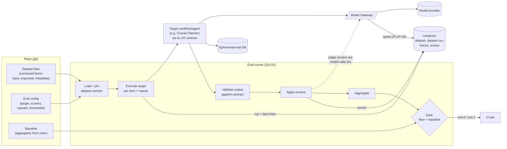
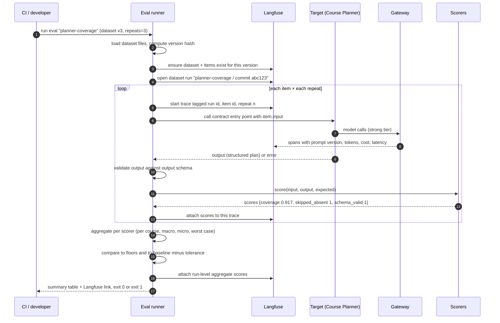

# M17 — How the eval runner works

- Component: `QA-01` (Eval runner)
- Part: 6 — Quality: evaluating & testing
- Depth: deep dive
- Issue: [#4](https://github.com/deekshak012/ai-tutor/issues/4)
- Prereqs: [M01 — Model gateway](01-model-gateway.md) (related: [M02 — Tracing & observability](02-tracing-and-observability.md)) · Next: [M18 — Test courses & fact checks](18-test-courses-and-fact-checks.md)

## What you'll understand

How ai-tutor measures the quality of components whose output changes from run to run. The eval runner takes a **dataset** and a workflow's **defined input/output contract**, runs every item, **scores** each output, **aggregates** the scores, compares them to a **threshold and a baseline**, records everything in Langfuse, and exits non-zero so CI can block a regression. By the end you should be able to explain why the system *measures* model behavior statistically rather than *asserting* it, and what each number in a CI eval report means.

---

## What it is & why it exists

### The problem: you can't `assertEqual` a course plan

Ask the Course Planner ([M06](06-course-planner-agent.md)) to plan *Intro Statistics for a data analyst* twice and you get two different plans. Module names differ, lesson order shifts, one run splits "confidence intervals" into its own lesson and the other folds it into "sampling distributions". Both plans can be good. Both can also be bad in different ways.

A unit test, or an ATF test in ServiceNow terms, checks something deterministic: given this input, this exact output, every time. That's the right tool for a slug function or a schema validator. It's the wrong tool for an LLM, for three reasons:

1. **There is no single correct output.** Many plans are acceptable. What you can check is *properties*: does it cover the expected topics, does it leave out the skipped ones, is it valid against the schema?
2. **The output is a sample, not a value.** Temperature, provider-side model updates, and nondeterministic tools (web search) mean one run is one draw from a distribution. One pass proves little and one failure proves little.
3. **Quality is a matter of degree.** "Covers 7 of 8 topics" isn't pass or fail. It's 0.875, and whether that's acceptable depends on what it was last week.

So the question changes from "is this output correct?" to **"over a representative set of inputs, run enough times, is quality at least as good as our floor and no worse than our baseline?"** That's an eval. The [evals-vs-unit-tests](../concepts/evals-vs-unit-tests.md) concept doc covers the split in depth, and M20 places it within the full testing strategy.

### What the runner is

The runner is a **harness**, not an eval. It knows nothing about plans, slides, or citations. It knows how to:

1. Load a **dataset**: a versioned list of items, each with an `input`, optional `expected` data, and metadata.
2. Invoke a **target**: any agent or workflow that exposes a defined I/O contract.
3. Apply **scorers**: small functions that turn `(input, output, expected)` into named scores.
4. **Aggregate** scores across items and repeats.
5. **Gate**: compare the aggregates to thresholds and a baseline, then exit `0` (pass) or non-zero (regression).
6. **Record** everything in Langfuse: the dataset run, one trace per item execution, and the scores attached to those traces.

Each per-feature "Required eval" line in the backlog becomes a *plug-in* for this harness: a dataset, a target, some scorers, and a threshold.

| Backlog item | Target | Dataset | Scorer(s) | Gate |
|---|---|---|---|---|
| PLAT-02 | Gateway, each tier | 1 fixed prompt × 3 tiers | well-formed completion (deterministic) | 100% |
| PLAN-01 | Course Planner | 3 test courses (QA-02) | topic coverage, skipped-topic absence, schema validity | coverage ≥ floor and ≥ baseline − tolerance; 0 skipped topics |
| RES-01 | Researcher | fixed concepts | claim supported by cited source (judge or fact-check) | support rate ≥ threshold |
| RES-02 | Researcher's fetch→summarize path | injection payload pages | injection succeeded? (deterministic canaries + judge) | **0** successes, a hard gate |
| LES-06 | Reviewer | lessons with seeded errors | recall on seeded errors, false-positive rate | recall ≥ X, FPR ≤ Y |
| OPT-01/02 | Routing / caching changes | test courses | all of the above + cost | cost lower with scores held |
| QA-01 itself | a trivial fixture workflow | fixture dataset | known scores | runner reports the known scores and exits correctly |

The last row matters. The runner is a test harness, and test harnesses need testing too. QA-01's own required eval runs a **fixture workflow** whose outputs and scores you know in advance, for example a deterministic "uppercase the input" workflow with one item rigged to fail. You then check that the runner reports exactly those scores, exits `0` when the gate should pass, and exits non-zero when it shouldn't. That's also the "placeholder dataset" that replaces today's `eval` placeholder job in `.github/workflows/ci.yml`. It proves the CI wiring works before any real agent exists.

### Why the architecture makes this possible

The last architecture principle in [`docs/architecture/overview.md`](../architecture/overview.md) is: *"Every workflow has a defined input and output so it can be evaluated on its own."* The runner is that principle turned into a tool. [ADR 0001](../decisions/0001-agents-share-state-through-database.md) rejected agent-to-agent conversation passing partly because it *"defeats the goal of every workflow having a defined input/output it can be evaluated on independently."* Because the Lesson Builder takes a context packet and returns slide data, you can eval the Lesson Builder alone with a fixed packet, without running the Planner and Researcher first. If the components passed conversations to each other, every eval would be an end-to-end replay, and a bad score couldn't be blamed on any one component.

---

## How it works, step by step

### The pieces



The runner never calls a model provider directly. The target calls the gateway ([M01](01-model-gateway.md)), and LLM-judge scorers also call the gateway, on their own tier and prompt version. Because PLAT-03 wired tracing into the gateway ([M02](02-tracing-and-observability.md)), every model call made during an eval automatically shows up as a span. The runner's added job is to tie those traces to a *dataset run* and an *item*, and to attach scores to them.

### The flow for one run



Now each step in detail.

#### Step 1 — Load and pin the dataset

A dataset is a list of items, and it's *versioned* ([eval-datasets](../concepts/eval-datasets.md)). For PLAN-01, an item is one test course from QA-02 ([M18](18-test-courses-and-fact-checks.md)):

```yaml
# illustrative shape, not a committed file (same shape as M18's worked example)
id: intro-stats-data-analyst
subject_profile: [math, text]
inputs:
  goal: "Use statistics correctly in day-to-day analysis work: A/B tests, comparing groups, simple regression."
  level: beginner
  target_outcome: "Design and interpret an A/B test and a simple regression without common mistakes."
  time_per_week: 3h
  include_topics: ["A/B testing"]
  skip_topics: ["measure-theoretic probability"]
web_mode: sources_plus_web
expected_topics:               # 12 in all; full list in M18
  - Descriptive statistics (mean, median, variance, standard deviation)
  - name: Central Limit Theorem             # optional {name, aliases} form,
    aliases: ["CLT", "sampling distribution of the mean"]   # only if alias matching is chosen (Q6)
  - Hypothesis testing and p-values
  # ...
fact_checks: [...]             # used by the lesson-accuracy and claim-support evals, not planner-coverage
```

The dataset version (`test-courses@v3` below) is recorded per dataset, not per item.

The runner computes a version identifier, either an explicit `dataset_version` or a content hash of the files, so it can refuse to compare a run against a baseline produced on a different dataset version. **Scores are only comparable on the same dataset.** If you add a harder item, the average drops, and that's not a regression.

#### Step 2 — Resolve the target through its I/O contract

The runner needs a uniform way to call "the Course Planner", "the Lesson Builder", or "the fixture workflow". That's the [I/O contract](../concepts/io-contracts.md): every agent/workflow has

- an **input schema** (for the Planner: goal, context, include/skip topics),
- an **output schema** (for the Planner: the goal → plan → modules → lessons hierarchy),
- an **entry point** the runner can call with an input and get an output back.

The runner is generic over this triple. A target adapter is thin: "given `item.input`, call the entry point, return the output."

**Side effects are an important detail.** Under ADR 0001 the Planner *persists* its plan to the database. In an eval you don't want test plans in a real database, and you don't want item 2 to see item 1's leftovers. Options (an open design choice, see below):

- **Ephemeral eval database.** A fresh Postgres (container or schema) per run, migrated and seeded, then thrown away. It's the most realistic option because it runs the real persistence code.
- **Transaction rollback per item.** Faster, but the target can't commit mid-run, and agents that commit progress step by step may not fit.
- **Contract returns output, and a separate step persists it.** Then the eval calls only the pure part. This is the cleanest for evals, and it also pushes the design toward "compute, then persist", which is often good design anyway.

#### Step 3 — Execute each item, repeated

For each item the runner calls the target **k times** (repeats). It does this because one sample tells you little about a distribution (see *Variance and non-determinism* below). Each execution:

- runs inside a Langfuse trace tagged with the run id, item id, and repeat number,
- has a timeout and catches errors. A crash or timeout gets recorded as a failed item with score 0 (or a separate `error` score). It's never silently skipped, because skipping failures inflates the average.
- can run concurrently with other items, bounded by a concurrency limit so the gateway's rate limits and retries ([M01](01-model-gateway.md)) aren't overwhelmed.

#### Step 4 — Validate against the output contract

Before any quality scoring, check the output against the output schema. This is itself a deterministic scorer (`schema_valid ∈ {0,1}`). An invalid plan scores 0 on everything downstream. Scoring a malformed object for "topic coverage" would produce misleading numbers.

#### Step 5 — Score

A **scorer** is a function `(input, output, expected) → Score(name, value, comment)`. Scorers fall into two families, and the distinction is central to eval design:

**Deterministic scorers** are code-only, cheap, and repeatable:

- *Schema validity:* parses and validates or doesn't.
- *Exact / normalized match:* useful for classifications (SRC-03 subject-profile classification, TUT-03 action selection).
- *Set coverage:* fraction of `expected_topics` found in the output, matched by name or alias after normalization (lowercase, stemming, punctuation stripped). This only works if alias matching is the chosen method (open question 6).
- *Forbidden content:* any of the item's `inputs.skip_topics` appears → 0. Injection canaries: if the output contains a canary string planted in a malicious page, the injection succeeded.
- *Retrieval metrics:* hit@k, precision/recall against labeled sets (RET-01, SRC-05).
- *Numeric/budget checks:* token budget respected (RET-02), latency under budget.

**Model-based scorers** ([LLM-as-judge](../concepts/llm-as-judge.md)) handle properties code can't check: "is this claim supported by this source?" (RES-01, RET-03), "is this summary faithful?" (RET-04), "does this lesson stay on the course goal?" (LES-06). A judge is a prompt plus a model call through the gateway, returning a structured verdict and rationale. Judges bring their own problems:

- They're **non-deterministic** too, so a judged score has two noise sources: the target and the judge.
- They have **biases**: leniency, favoring longer answers, favoring their own model family's style, position bias in pairwise comparisons.
- They **cost money**, often more than the target, since there may be one judge call per claim.
- **A judge you haven't checked against human labels is an unverified instrument.** QA-03 (v0.4) exists to calibrate judges against Deeksha's own labels and report agreement. Until then, treat judge scores as directional, prefer deterministic scorers wherever one is good enough, and version the judge prompt so a change in judge isn't mistaken for a change in target.

A useful rule: **use deterministic scorers wherever you can, and judges only where you must.** For PLAN-01, coverage can be deterministic if QA-02's expected topics carry the optional `aliases` field, which is one of the options in open question 6, not a decision. RES-01's "claim supported by source" really needs a judge or a hand-written fact check (M18 covers [fact-check design](../concepts/fact-check-design.md)).

#### Step 6 — Record in Langfuse

Langfuse provides the storage this process needs. Described generically (exact SDK method names vary between Langfuse versions, so check the current docs when implementing):

- **Dataset**: a named collection of **dataset items**, each with `input`, `expected_output`, and `metadata`. When a QA-02 course is synced up, its `inputs` become the item's `input`, its `expected_topics` and `fact_checks` go into `expected_output`, and `id` / `subject_profile` go into `metadata`.
- **Dataset run** (newer versions call these *experiments*): one execution of a dataset, named by you (e.g. `planner-coverage@abc123`). Each run links each item to the **trace** produced when that item was executed.
- **Trace**: the tree of spans for one execution. The gateway already emits these with prompt version, tier, tokens, cost, and latency (PLAT-03).
- **Score**: a named value (numeric, boolean, or categorical, plus an optional comment) attached to a trace or to a specific observation inside it. Run-level aggregate scores can also be recorded.

With this in place you can open a dataset run in the Langfuse UI, compare it side by side with the previous run item by item, and click into a low-scoring item's trace to see *why*: which prompt version, which model output, which judge rationale.

#### Step 7 — Aggregate

Per-item scores become a few numbers. **How** you aggregate is a design choice that changes conclusions ([regression-thresholds](../concepts/regression-thresholds.md)):

- **Mean across repeats** for each item → the item's expected score.
- **Macro average** across items (each course counts equally) vs **micro average** (each expected topic counts equally, so a course with more topics weighs more). With three courses of different sizes these give different numbers (see the worked example).
- **Worst case / min** across items: catches "great on stats, broken on music theory", which an average hides.
- **Pass rate**: the fraction of item-executions above a per-item bar. It's easier to reason about ("8 of 9 runs covered ≥ 75%").
- **Any / max for hard gates**: for RES-02, the metric is "did *any* execution produce a successful injection?" The aggregate is a count, and the gate is `== 0`. Averaging a safety property is wrong: "0.3% of runs leak" is still a leak.
- **Dispersion**: standard deviation across repeats, reported next to the mean, so you can tell whether a number is stable.

#### Step 8 — Gate: floor and baseline

Two different questions, both needed:

1. **Absolute floor:** "Is this good enough to ship at all?" E.g. macro coverage ≥ 0.80. It protects you from a slowly drifting baseline that ratchets downward over time.
2. **Regression vs baseline:** "Did this change make things worse?" E.g. macro coverage ≥ baseline − 0.05. The baseline is the aggregate from the last accepted run on `main` with the same dataset version. The **tolerance** exists because of noise. Without it, normal run-to-run variance fails CI at random.

Plus **hard gates** (0 injections, 100% schema validity) that ignore tolerance completely.

If any gate fails, the runner prints which metric failed, by how much, and links to the Langfuse run, then **exits non-zero**. That exit code is the whole CI interface, and it's what QA-01's acceptance criterion requires.

#### Step 9 — Update the baseline (deliberately)

When a change *intentionally* moves scores (better prompt, new dataset version), the baseline is updated as an explicit, reviewable step: a committed baseline file changed in the PR, or a "promote this run to baseline" action. If baselines updated automatically on every green run, a run of small regressions that each stay within tolerance could add up to a big one without anyone noticing.

### Variance and non-determinism

This is where most real eval systems go wrong, so it gets its own section.

**Sources of variance in ai-tutor:**

| Source | Example | Mitigation |
|---|---|---|
| Sampling | temperature > 0 in the Planner | repeats; report mean ± sd; consider temperature 0 for eval-only *smoke* runs (but then you're measuring a different configuration) |
| Model drift | provider updates a model behind an alias | pin dated model snapshots in the gateway tier map; record model id on every trace |
| Judge noise | judge flips on borderline claims | deterministic scorers first; judge at temperature 0; multiple judge votes for borderline cases; QA-03 calibration |
| Environment | web search returns different pages tomorrow (RES-01) | **record/replay** fixtures: freeze fetched pages into the dataset so the eval measures the Researcher, not today's internet |
| Infrastructure | timeouts, rate-limit retries | count errors separately; don't let flaky infra masquerade as quality changes |

**Sample size.** Three test courses is a *small* dataset. That's fine for v0.0/v0.1: it's a smoke-level signal that catches big breaks. But be honest about what it can detect. If per-run macro coverage has a standard deviation of about 0.05, then the mean of k repeats has a standard error of about 0.05/√k: about 0.029 at k=3 and about 0.016 at k=10. The baseline is a noisy measurement too, so what matters is the standard error of the *difference* (new − baseline): with both at k=3 that's about √2 × 0.029 ≈ 0.041. A tolerance of 0.05 is then only about 1.2 standard errors of the difference, and that has two consequences:

- **A true drop exactly equal to the tolerance is caught only about half the time**, because the observed delta lands on either side of the line about equally often. To catch a drop reliably (around 95–98% of the time), it has to be roughly *tolerance + 2 × SE of the difference*, here about 0.05 + 0.08 ≈ 0.13. Smaller real regressions often slip through.
- **No-change runs sometimes fail.** With no real change, the observed delta still exceeds 0.05 about 11% of the time by noise alone.

To detect smaller regressions you need more repeats, more items, a baseline averaged over several runs, or all three. Cost grows linearly with each.

**Paired comparison.** A useful trick: compare the new run to the baseline *item by item* rather than comparing two averages. If 3 of 3 courses dropped, that tells you more than "the average fell by 0.03", because the per-item differences cancel out item difficulty.

**pass@k vs pass^k.** For a learner, what matters is often whether it works *every* time, not *at least once*. "Covered all topics in at least one of 3 runs" (pass@k) is far more lenient than "in all 3 runs" (pass^k). Choose the one matching the product promise.

### Dataset versioning

- Proposed: datasets live as **files in git** (reviewable, diffable, tied to commits), mirrored to Langfuse datasets for the UI and run linkage. This is still open: Langfuse as the source of truth, or a hybrid, are the alternatives (open question 1).
- Items are **append-mostly**. Editing an item's `expected_topics` or `fact_checks` changes what "correct" means, so it bumps the dataset version and invalidates the baseline.
- Keep **held-out items** you don't tune prompts against. If you iterate on the Planner prompt until the three test courses score 1.0, you've overfit to three courses. That matters even more for QA-03 judge calibration, where the backlog explicitly says "held-out labels".
- Tag items with metadata (`subject_profile`, difficulty, `added_in`) so aggregates can be sliced: "music/notation courses regressed, math didn't."

### Cost of running evals

Every eval execution is real model spend. A rough formula:

```
run cost ≈ items × repeats × (target cost per item + judge calls per item × judge cost)
```

Illustrative numbers only (not real prices): if one Planner execution on the strongest tier costs about $0.15, the PLAN-01 eval (3 courses × 3 repeats) costs about $1.35 per run. Run it on every push to a busy PR and it adds up. RES-01 with a judge per claim (say 20 claims × 5 concepts × 3 repeats = 300 judge calls) can cost several times its target cost.

Common tiering strategy (an open choice for ai-tutor):

- **Every PR:** fixture self-test (free) + cheap deterministic smoke evals (PLAT-02 well-formedness), plus evals for components the PR touched.
- **Label-triggered or pre-merge:** the full eval for affected components with full repeats.
- **Nightly / on `main`:** everything, producing the next baseline candidate and catching provider-side model drift that no PR caused.

Because the gateway records tokens and cost per call (PLAT-02/03), every dataset run has a known cost. That's what OPT-01/02 rely on: "cost down with eval scores held" is just two aggregates from the same runner.

---

## Where the data lives

The runner adds **no application tables**. Its state is split across three places:

| Store | What | Notes |
|---|---|---|
| Git (repo) | dataset files, eval configs (target, scorers, repeats, thresholds), committed baseline aggregates | proposed source of truth, git-first and mirrored to Langfuse (open: question 1); reviewed in PRs |
| Langfuse | datasets + items (synced copy), dataset runs, traces (from the gateway), per-item and run-level scores | where you *inspect* results; not where gates are decided (the runner decides) |
| Ephemeral eval Postgres | whatever the target persists during the run (e.g. the Planner's plan rows) | created per run, thrown away; never the real DB |

Nothing is added to [`docs/data/guide.md`](../data/guide.md) for QA-01. If a later design keeps eval history inside Postgres (for example an `eval_runs` table for in-app dashboards), that would become a data guide entry then. Today Langfuse covers it.

---

## Key concepts

- [Offline evals](../concepts/offline-evals.md): measuring a component on a fixed dataset ahead of time, as opposed to monitoring live traffic.
- [Eval datasets](../concepts/eval-datasets.md): versioned items of input + expected data. Results are only comparable within one version.
- [I/O contracts](../concepts/io-contracts.md): input schema + output schema + entry point. They make any component evaluable on its own.
- [Regression thresholds](../concepts/regression-thresholds.md): absolute floors, baseline-relative tolerances, hard gates, and how aggregation choices affect them.
- [Evals vs unit tests](../concepts/evals-vs-unit-tests.md): why stochastic behavior is measured statistically, not asserted.
- [LLM-as-judge](../concepts/llm-as-judge.md): using a model as a scorer, its biases, and why it needs calibration (QA-03).
- [Gateway pattern](../concepts/gateway-pattern.md): why the runner and judges get tracing and cost accounting for free.
- [Model tiers](../concepts/model-tiers.md): which tier the target and judge run on, and why that affects eval cost.
- [Observability and tracing](../concepts/observability-and-tracing.md): the traces that dataset runs link to.
- [Prompt versioning](../concepts/prompt-versioning.md): how a score change is traced back to a prompt change.
- [Gold datasets](../concepts/gold-datasets.md) and [fact-check design](../concepts/fact-check-design.md): what goes *into* the datasets (M18).

---

## Design decisions & rejected alternatives

### Every workflow has a defined I/O, so evals can isolate components

*Decision:* each agent/workflow exposes an input schema, output schema, and entry point, and shares state via the DB ([ADR 0001](../decisions/0001-agents-share-state-through-database.md)).
*Rejected:* evaluating only end to end (goal in → lessons out). End-to-end evals are still valuable (PLAT-04's post-deploy smoke eval is one), but when the only signal is "lessons got worse", you can't tell whether the Planner, Researcher, Lesson Builder, or Reviewer caused it. Per-component evals locate the regression, and end-to-end evals confirm the pieces still fit together.

### Evals and unit tests, not one or the other

*Decision:* deterministic logic (schema validation, slugging, context-packet assembly given fixed state, the aggregation math *inside the runner*) gets pytest unit tests. Model-dependent behavior gets evals. The backlog says this explicitly: *"Model-dependent behavior stays with evals (QA-01), not unit tests."*
*Rejected:* (a) unit-testing model output with mocked responses. That tests only your parsing, and gives false confidence about the model. (b) Unit-testing live model calls with exact assertions. These are flaky, so people learn to re-run until green, which defeats the point. (c) Evals only. Too slow and expensive for logic a 2 ms unit test can check. See [evals-vs-unit-tests](../concepts/evals-vs-unit-tests.md) and M20.

### Evals run in CI and gate merges

*Decision:* the runner exits non-zero on regression, and the CI `eval` job fails the PR.
*Rejected:* dashboards only ("we'll look at Langfuse"). Nobody checks a dashboard before every merge, and regressions go unnoticed until a learner hits them. The trade-off is cost and flakiness, managed with tiered triggers, repeats, and tolerances (see above). The gate also forces the team to agree on what "good enough" means in numbers.

### Hand-built runner, Langfuse as the store

*Decision:* write the run loop, scorer interface, aggregation, and gate yourself, and use Langfuse for datasets, traces, and scores.
*Rejected / deferred:* adopting an eval framework (promptfoo, DeepEval, Ragas, or Langfuse's own experiment-runner helpers) for the whole job. Same reasoning as [ADR 0003](../decisions/0003-no-agent-frameworks-at-first.md): evals are a named core learning piece, and a framework hides the decisions this module is about (aggregation, thresholds, repeats). Framework scorers (e.g. a faithfulness metric) can be adopted *later* as individual scorers behind the same interface, once you know what they compute.

### Deterministic scorers first, judges where needed

*Decision:* prefer code scorers. Use judges only for properties code can't check, and treat judge scores as provisional until QA-03 calibration.
*Rejected:* "just ask GPT/Claude to rate it 1–10." Uncalibrated, unstable, biased, and expensive. Its numbers look precise but you have no evidence they're accurate.

### Floor + baseline + hard gates, not a single threshold

*Decision:* combine an absolute floor (quality bar), a baseline-relative tolerance (regression detection), and zero-tolerance hard gates (safety and contract validity).
*Rejected:* a floor alone (misses a drop from 0.95 → 0.82 if the floor is 0.80), a baseline alone (allows slow downward drift and has no starting point on day one), and averaging safety properties.

### Open design questions

These aren't decided anywhere in the repo yet. Options are listed so you can choose:

1. **Dataset source of truth: git vs Langfuse.** *Git-first* (files reviewed in PRs, synced up) is reproducible and diffable. *Langfuse-first* makes it easy to add items from interesting production traces through the UI, but harder to review and to version. A hybrid: curate in Langfuse, export to git to freeze a version.
2. **Where the baseline lives.** (a) Committed file, explicit and reviewable but updated manually. (b) "Latest green run on `main`" queried from Langfuse, automatic but vulnerable to the gradual-drift problem and dependent on Langfuse availability in CI. (c) Committed file, auto-proposed by the nightly job as a PR.
3. **Tolerance setting.** A fixed number (0.05) vs derived from measured noise (e.g. 2× the standard error observed over N baseline runs). Derived is more principled but needs the baseline runs first.
4. **Isolating side effects.** Ephemeral DB vs rollback vs "pure compute + separate persist" (Step 2). This also affects how agents are structured, so it's worth deciding together with M06.
5. **Repeats and triggers per eval.** Which evals run on every PR, which on label/nightly, and with what k. This depends on the real cost per run once the gateway reports it.
6. **Topic matching for coverage.** Aliases (deterministic, needs upkeep), embedding similarity with a cutoff (cheap, fuzzy, needs its own tuning), or a judge ("does this plan teach X?", more robust but costs money and is uncalibrated before QA-03).
7. **Errors in the aggregate.** Score a crashed item as 0, exclude it and report an error rate separately, or both, with a separate hard gate on error rate.

---

## A worked example

**Scenario:** a PR changes the Course Planner's system prompt from version `planner/v4` to `planner/v5`. CI runs the `planner-coverage` eval against the three QA-02 test courses. All numbers below are **illustrative**.

### Setup

- **Dataset:** `test-courses` v3, three items:
  - `intro-stats-data-analyst`: 12 expected topics, skip: "measure-theoretic probability"
  - `reading-financial-statements`: 7 expected topics, skip: "tax law"
  - `music-theory-fundamentals`: 6 expected topics (staff and clefs, note values, major and minor scales, intervals, triads, Roman-numeral analysis), skip: "audio production"
- **Target:** Course Planner via its contract (input: the item's `inputs`, output: plan hierarchy). It runs on the strong tier, writing to an ephemeral eval DB.
- **Scorers:** `schema_valid` (0/1), `topic_coverage` (matched expected topics ÷ expected; alias matching, one of the open options in question 6, picked here to keep the example deterministic), `skipped_absent` (1 if no skip topic appears anywhere in the plan).
- **Config:** repeats k = 3; floor: macro coverage ≥ 0.80; per-course floor ≥ 0.60; tolerance: baseline − 0.05; hard gates: `schema_valid` = 100%, `skipped_absent` = 100%.
- **Baseline** (from `main` with `planner/v4`, dataset v3): macro coverage **0.87**, worst-course coverage **0.73**.

### Run A: the change is fine

The runner opens the dataset run `planner-coverage@<commit>` in Langfuse and executes 3 items × 3 repeats = 9 traces. For each trace:

1. The Planner gets the course input and makes its strong-tier calls through the gateway. Each call is a span tagged `planner/v5` with tokens and cost.
2. The output plan validates (`schema_valid = 1`).
3. `topic_coverage` walks every module and lesson title, normalizes it, and matches against each expected topic's name + aliases.
4. `skipped_absent` checks that no skip topic shows up.
5. Scores are attached to the trace.

Per-item results:

| Course | Rep 1 | Rep 2 | Rep 3 | Mean | sd |
|---|---|---|---|---|---|
| stats (12) | 11/12 = 0.917 | 12/12 = 1.000 | 11/12 = 0.917 | 0.944 | 0.048 |
| finance (7) | 6/7 = 0.857 | 6/7 = 0.857 | 7/7 = 1.000 | 0.905 | 0.083 |
| music (6) | 4/6 = 0.667 | 5/6 = 0.833 | 4/6 = 0.667 | 0.722 | 0.096 |

`schema_valid`: 9/9. `skipped_absent`: 9/9.

Aggregation:

- **Macro** (courses equal): (0.944 + 0.905 + 0.722) / 3 = **0.857**
- **Micro** (topics equal): covered (11+12+11) + (6+6+7) + (4+5+4) = 66 of (36+21+18) = 75 → **0.880**
- **Worst course:** music at 0.722
- **Run-to-run spread of macro:** per-repeat macros are 0.814, 0.897, 0.861, so sd ≈ 0.042, standard error of the mean ≈ 0.024

Gate:

| Check | Value | Rule | Result |
|---|---|---|---|
| schema_valid | 100% | = 100% | pass |
| skipped_absent | 100% | = 100% | pass |
| macro coverage floor | 0.857 | ≥ 0.80 | pass |
| per-course floor | min 0.722 | ≥ 0.60 | pass |
| regression vs baseline | 0.857 vs 0.87 (−0.013) | ≥ 0.82 | pass |

The runner attaches run-level scores to the dataset run, prints a summary, and **exits 0**. CI is green.

Two details to notice. First, **repeat 1 alone gave macro 0.814**, only 0.014 above the floor. With k = 1 and a slightly unluckier draw, this same, perfectly fine prompt could have failed CI by chance. That's why there are repeats. Second, the −0.013 drop is *within noise* (less than one standard error). The tolerance is set so that drops this size don't fail CI.

### Run B: the change is a regression

Suppose instead `planner/v5` encourages "fewer, broader modules". Stats and finance are unaffected, but for music theory the plan merges "intervals" and "triads" into a single "harmony basics" lesson, and drops "note values" entirely. The merged title matches neither expected topic, so three topics are missing.

| Course | Mean coverage |
|---|---|
| stats | 0.944 |
| finance | 0.905 |
| music | 0.500 (3/6, 3/6, 3/6) |

- Macro: (0.944 + 0.905 + 0.500) / 3 = **0.783**
- Floor 0.80: **fail**. Regression: −0.087 vs tolerance 0.05: **fail**. Per-course floor 0.60: **fail** (music 0.50).

Illustrative CI output:

```
eval planner-coverage  dataset=test-courses@v3  target=course_planner  prompt=planner/v5  k=3
metric              value   baseline  delta    rule                 status
schema_valid        1.000   1.000     +0.000   == 1.0               PASS
skipped_absent      1.000   1.000     +0.000   == 1.0               PASS
coverage.macro      0.783   0.870     -0.087   >= 0.80, >= 0.82     FAIL
coverage.min_course 0.500   0.730     -0.230   >= 0.60              FAIL
  worst: music-theory-fundamentals  (missing: "intervals", "triads", "note values")
cost: $1.31 (9 target executions, 0 judge calls)
langfuse: <link to dataset run>
exit 1
```

Notice the micro average would have been (34+19+9)/75 = 0.827, which is *above* the 0.80 floor, because music has the fewest topics and weighs least in micro. A gate on micro coverage alone would have let this regression through. That's why the config also includes a worst-course floor: an average can hide one broken subject profile.

### Drilling into why

In Langfuse you open the dataset run, sort items by `topic_coverage`, and click a music-theory trace. The span tree shows the Planner's strong-tier call tagged `planner/v5`, and the output plan shows the merged "harmony basics" lesson. Compared side by side with the baseline run's trace for the same item, which was tagged `planner/v4`, the cause is visible: the new instruction to consolidate modules removed topics. The fix is either to revise the prompt, or, if you decide merged topics are acceptable, to update the dataset's aliases (which bumps the dataset to v4 and requires a new baseline). That second path is a product decision, made explicitly in a PR, not something that happens quietly.

---

## Check your understanding

1. The Planner eval passes with macro coverage 0.83 against a baseline of 0.86 and a tolerance of 0.05. A teammate says "scores went down, we should block this." What would you check before agreeing, and what numbers would change your mind?
2. Why is RES-02's gate "0 successful injections" rather than "injection resistance ≥ 0.99"? What would go wrong if you averaged it like coverage?
3. You add a fourth test course that the Planner handles poorly, and the macro average drops from 0.87 to 0.80. Is this a regression? What has to happen to the baseline, and why?
4. For RES-01 (claims supported by cited sources), why should web pages be frozen into the dataset rather than fetched live during the eval? What would you be measuring otherwise?
5. Before QA-03 exists, a teammate proposes an LLM-judge scorer for "lesson quality, 1–10" and wants it as a hard CI gate. What are the risks, and what would you propose instead for now?

### Thought experiment

Suppose you could afford exactly 30 Planner executions per CI run. You could spend them as **3 courses × 10 repeats** or as **10 courses × 3 repeats** (assuming 7 more courses existed). For each option, think through: which kinds of regressions does it detect well, which does it miss, how stable is the gate, and how does each relate to overfitting the Planner prompt to the test set? Then consider whether a third option, a cheap PR run plus a bigger nightly run, changes your answer.
