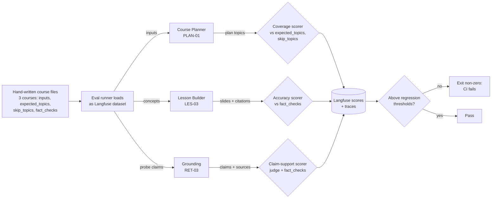

# M18 — How the test courses & fact checks work

- Component: `QA-02` (Three test courses: expected topics + fact checks)
- Part: 6 — Quality: evaluating & testing
- Depth: light
- Issue: [#5](https://github.com/deekshak012/ai-tutor/issues/5)
- Prereqs: [M17 — How the eval runner works](17-eval-runner.md) · Next: [M19 — How E2E testing (Playwright) works](19-e2e-testing-playwright.md)

## What you'll understand

By the end you should be able to explain what the three test courses are, what goes into each one (goal, context, expected topics, fact checks), and how the eval runner uses them to score the Course Planner, the Lesson Builder, and grounding. You should also be able to say why there are three courses on very different subjects, not one.

## What it is & why it exists

M17 described the eval runner: it takes a dataset, runs a workflow against each item, scores the outputs, and fails if a score drops below a threshold. The runner says nothing about what is in the dataset. QA-02 provides the data.

QA-02 is a small, hand-written [gold dataset](../concepts/gold-datasets.md). It holds three course definitions, and each one includes:

1. **Inputs**: what a learner would type into the course-creation form: goal, why, level, target outcome, time per week, include/skip topics, and web mode. These are a subset of the Course object's fields in CRS-01 ([M05](05-course-model.md)); fields that don't change what a plan should *cover*, such as deadline and preferred style, are left out.
2. **Expected topics**: the topics a competent human tutor would put in the plan. These are the reference answer for planning.
3. **Fact checks**: five or more short claims, each marked true or false, that any lesson or answer on that topic has to get right. These are the reference answer for accuracy.

This matters because nearly every model-driven feature in v0.1 has a "Required eval" that points back to these courses:

| Consumer | Feature | What it uses from QA-02 | Metric |
|---|---|---|---|
| PLAN-01 | Course Planner ([M06](06-course-planner-agent.md)) | inputs → expected topics, skip topics | topic coverage ≥ threshold; 0 skipped topics present |
| LES-03 | Lesson Builder ([M11](11-lesson-builder-workflow.md)) | fact checks | slide accuracy (no slide contradicts a fact check) |
| RET-03 | Grounding & citations ([M09](09-grounding-and-citations.md)) | fact checks + course topics as fixed probes | claim-support rate |
| v0.3+ | Subject profiling & ingestion | the spread of [subject profiles](../concepts/subject-profiles.md) | per-profile behavior |
| v2.x QA-05 | Learning-outcome study | the same three courses | pre/post learning |

The project rule "every workflow has a defined input and output so it can be evaluated on its own" (see [architecture overview](../architecture/overview.md)) depends on having something to evaluate against. These three courses are that baseline. They are written once in v0.0 and reused in every release after it, which is why the [backlog](../backlog/backlog-draft.md) (QA-02) calls them the "backbone eval set".

## How it works, step by step

1. **Author by hand.** Each course definition is hand-written gold data. Picking the ground truth is the judgment call in an eval, so in the original plan the author was meant to be the human expert rather than a model. A model doesn't write it, because that would mean grading the model against its own answers.
2. **Store as versioned files** (proposed: git-first, mirrored to Langfuse; the source of truth is still open, see [M17](17-eval-runner.md) open question 1). The definitions live in the repo as plain data files, so changes show up in diffs and get reviewed like code. The runner loads them into a Langfuse dataset (see [M02](02-tracing-and-observability.md), [M17](17-eval-runner.md)), so each eval run is linked to the exact dataset version it used.
3. **The runner fans out by consumer.** A given eval reads only the part of each course it needs:
   - The **planning eval** sends `inputs` to the Course Planner, gets a plan back, and compares the plan's topics with `expected_topics`.
   - The **lesson-accuracy eval** builds lessons for the course's concepts, then checks each slide against the `fact_checks` tagged with that slide's topic.
   - The **claim-support eval** runs grounded generation and checks that each claim is supported by its cited source. The fact checks act as known-answer probes: a cited claim that contradicts a fact check fails even when the citation looks fine.
4. **Score, compare to threshold, exit.** Scores go to Langfuse. The runner exits non-zero if any score falls below its [regression threshold](../concepts/regression-thresholds.md) (M17).



**How topics get matched.** A plan won't use the exact wording "Hypothesis testing and p-values". It might say "Testing claims with data". So plain string matching on the topic name isn't enough. How to match is an **open choice** ([M17](17-eval-runner.md), open question 6): deterministic matching against hand-written aliases (each expected topic can optionally carry an `aliases` list), embedding similarity with a cutoff, or a cheap [LLM judge](../concepts/llm-as-judge.md) deciding, for each expected topic, whether any plan topic covers it. Aliases are cheap and repeatable but need upkeep; a judge is more robust but costs money and is uncalibrated before QA-03. Whatever the method, the score is `covered / expected`. Skip topics are checked the other way: a single match is a failure.

**How fact checks get applied.** A fact check is a claim plus a verdict. True claims are things a lesson must not contradict. False claims are common misconceptions a lesson must not state. The scorer asks, per slide, whether the slide states or implies the false claim, or contradicts the true one. See [fact-check design](../concepts/fact-check-design.md) for why each check is small, atomic, and tagged to one topic.

## Where the data lives

- **v0.0–v0.1: no Postgres tables.** This is eval data, not product data. A learner never sees it, so it stays out of the application database. The proposed storage is git-first, mirrored to Langfuse (open; see [M17](17-eval-runner.md) open question 1): versioned data files in the repo (for example `evals/datasets/test_courses/*.yaml`; the exact path is also open), which the runner mirrors into a **Langfuse dataset**, where every run is stored with its scores and traces.
- **Product tables touched indirectly:** the planning eval writes a real course plan through the normal path (Course → plan → modules → lessons, per ADR 0001), most likely into a throwaway eval database or schema. See [M03](03-backend-and-data-store.md) and [`docs/data/guide.md`](../data/guide.md).

## Key concepts

- [Gold datasets](../concepts/gold-datasets.md): small, trusted, hand-labeled reference sets that evals score against.
- [Fact-check design](../concepts/fact-check-design.md): how to write claims that are atomic, unambiguous, include misconceptions, and can be scored automatically.
- [Subject profiles](../concepts/subject-profiles.md): text-heavy, visual, math, code, diagrams, mixed. Why test coverage should span them.
- [Eval datasets](../concepts/eval-datasets.md): the general idea that a gold dataset is one kind of.
- [Offline evals](../concepts/offline-evals.md): scoring ahead of time, in CI, without live users.
- [Regression thresholds](../concepts/regression-thresholds.md): the pass/fail line the runner enforces.
- [LLM-as-judge](../concepts/llm-as-judge.md): how fuzzy matches (topic coverage, contradiction) get scored.

## Design decisions & rejected alternatives

- **Three courses on different subjects, not one deep course.** A tutor that is "generic, course-based" ([product spec](../product-spec.md)) can't be judged on statistics alone. Each course pushes on something different:
  - *Intro Statistics for a data analyst*: **math + text**. Formal definitions and well-known misconceptions, which makes it the strongest test of factual accuracy.
  - *Reading financial statements*: **text + visual/tables**. The goal is to read a 10-K, so the content is structured tables (income statement, balance sheet, cash flow) and how they relate. Fact checks look like "the three statements are linked through net income and the change in cash".
  - *Fundamentals of music theory*: **notation + visual**. Sheet music and chord progressions. Much of the meaning is in symbols, not prose, which later stresses visual ingestion, generated diagrams, and "what do you see?" exercises.

  *Rejected:* one large course, which would overfit the planner and prompts to one domain. Also rejected: a dozen courses, which is too much for one person to label carefully. Three is the smallest number that covers clearly different profiles.
- **Hand-written expectations as ground truth.** *Rejected:* having a strong model generate expected topics or fact checks. The eval would then measure agreement with another model, and errors the two share would pass unnoticed. Hand-writing also forces the author to decide what "good" looks like, which is the same skill QA-03's judge calibration needs later.
- **Include false claims (misconceptions), not just true ones.** If every check is true, a lesson can pass by being vague. False checks catch the specific errors a weak lesson tends to make, such as "a p-value is the probability the null is true".
- **Small, atomic checks over long reference answers.** A single claim is easy to verify and easy to explain when it fails. *Rejected:* comparing the whole lesson to a reference lesson. That would score style and phrasing, not correctness.
- **Files in the repo, mirrored to Langfuse** (proposed; the source of truth is still open, see [M17](17-eval-runner.md) open question 1). *Argued against:* keeping the data only in the Langfuse UI. That loses code review and git history. In the repo, a change to the gold data goes through a PR like any other change.
- Related ADRs: [0001](../decisions/0001-agents-share-state-through-database.md) (the planning eval reads the plan from the DB, not from a conversation), [0002](../decisions/0002-course-first-with-optional-sources.md) (courses are the central object, and these test courses run with no uploads).

## A worked example

> **Illustrative only.** The data below shows what one course definition could look like. It is **not a committed dataset**; the course choice and every entry are illustrative. Field names are a sketch, and [M17](17-eval-runner.md) uses the same shape.

```yaml
# Illustrative shape only, not a committed dataset.
id: intro-stats-data-analyst
subject_profile: [math, text]
inputs:
  goal: "Use statistics correctly in day-to-day analysis work: A/B tests, comparing groups, simple regression."
  why: "I'm a data analyst who runs queries and dashboards but isn't confident interpreting test results."
  level: beginner            # comfortable with spreadsheets/SQL, no formal stats
  target_outcome: "Design and interpret an A/B test and a simple regression without common mistakes."
  time_per_week: 3h
  include_topics: ["A/B testing"]
  skip_topics: ["measure-theoretic probability"]
web_mode: sources_plus_web

expected_topics:             # coverage threshold applied over this list
                             # an entry may optionally be {name, aliases: [...]} if alias matching is chosen (M17 Q6)
  - Descriptive statistics (mean, median, variance, standard deviation)
  - Probability distributions and the normal distribution
  - Sampling and sampling distributions
  - Central Limit Theorem
  - Standard error vs standard deviation
  - Confidence intervals
  - Hypothesis testing and p-values
  - Type I and Type II errors, statistical power
  - Comparing two groups (t-tests)
  - A/B testing in practice
  - Correlation vs causation
  - Simple and multiple linear regression, interpreting coefficients

fact_checks:
  - id: pval-def
    topic: Hypothesis testing and p-values
    claim: "A p-value is the probability, assuming the null hypothesis is true, of observing data at least as extreme as what was observed."
    verdict: true
  - id: pval-misconception
    topic: Hypothesis testing and p-values
    claim: "A p-value of 0.03 means there is a 3% probability that the null hypothesis is true."
    verdict: false
  - id: clt-condition
    topic: Central Limit Theorem
    claim: "For independent samples from a population with finite variance, the sampling distribution of the sample mean approaches a normal distribution as sample size grows, whatever the population's shape."
    verdict: true
  - id: clt-misconception
    topic: Central Limit Theorem
    claim: "The Central Limit Theorem says a large sample's individual data values will be normally distributed."
    verdict: false
  - id: corr-causation
    topic: Correlation vs causation
    claim: "A strong correlation between two variables is, by itself, sufficient evidence that one causes the other."
    verdict: false
  - id: corr-linear
    topic: Correlation vs causation
    claim: "A Pearson correlation near zero rules out any relationship between two variables."
    verdict: false   # r measures only linear association; a strong nonlinear relationship can have r ≈ 0
  - id: reg-coef
    topic: Simple and multiple linear regression, interpreting coefficients
    claim: "In a multiple linear regression, a coefficient is the expected change in the outcome for a one-unit increase in that predictor, holding the other predictors constant."
    verdict: true
  - id: type-errors
    topic: Type I and Type II errors, statistical power
    claim: "A Type I error is rejecting a null hypothesis that is actually true; a Type II error is failing to reject a null hypothesis that is actually false."
    verdict: true
  - id: power-def
    topic: Type I and Type II errors, statistical power
    claim: "Statistical power is the probability of correctly rejecting a false null hypothesis, equal to 1 minus the Type II error rate."
    verdict: true
  - id: ci-misconception
    topic: Confidence intervals
    claim: "A 95% confidence interval means there is a 95% probability that the true parameter lies inside this particular computed interval."
    verdict: false   # frequentist: 95% of intervals built this way would contain the parameter
  - id: se-formula
    topic: Standard error vs standard deviation
    claim: "The standard error of the sample mean equals the population standard deviation divided by the square root of the sample size."
    verdict: true
```

**How the runner uses it:**

1. **Planning eval (PLAN-01).** The runner sends `inputs` to the Course Planner. Say the plan has 11 topics. The coverage scorer (whichever matching method is chosen) matches 11 of the 12 expected topics, and nothing covers "Standard error vs standard deviation". Coverage is 11/12 ≈ 0.92. With a threshold of 0.85 this passes, and the Langfuse trace names the missing topic so it's easy to see. If any plan topic matched "measure-theoretic probability", the run would fail no matter what the coverage was.
2. **Lesson-accuracy eval (LES-03).** The runner builds the lesson for "Hypothesis testing and p-values" and checks its slides against `pval-def` and `pval-misconception`. Say a speaker note reads "p = 0.03, so there's only a 3% chance the null is true." That states the false claim, so the slide fails. The score is the share of (slide, applicable check) pairs that pass. One small mistake is enough to show up.
3. **Claim-support eval (RET-03).** Grounded output for "Central Limit Theorem" has to cite a source for each claim. Say a claim is cited to a real web page but says "with n ≥ 30 your data becomes normal." The judge may decide the citation supports it, because a low-quality source might say exactly that. The claim still states the misconception recorded as `clt-misconception` (a claim whose verdict is false), so it fails. This is why fact checks sit alongside judge-based support checks: a citation can be faithful to its source and still be wrong.

**The other two courses, briefly (also illustrative):**

- *Reading financial statements*: goal "read a 10-K and judge a company's health". Topics include the income statement, the balance sheet (assets = liabilities + equity), the cash flow statement, accrual vs cash accounting, and key ratios. Example fact check: "Net income and operating cash flow can differ because of non-cash items and working-capital changes" (true).
- *Fundamentals of music theory*: goal "read sheet music and analyze chord progressions". Topics include the staff and clefs, note values, major and minor scales, intervals, triads, and Roman-numeral analysis. Example fact check: "A major triad is a root, a major third, and a perfect fifth" (true).

## Check your understanding

1. Why does the eval runner (M17) need QA-02 at all? What could it measure without any gold data?
2. Pick one of the false fact checks above. Why is it more useful than its true counterpart for catching a weak lesson?
3. The planner writes "Testing claims with data" and the expected topic is "Hypothesis testing and p-values". Which scorer decides whether that counts, and what could go wrong with it?
4. Why do the expected topics need to be hand-written rather than generated by the strongest model?
5. What does the music theory course test that the statistics course can't?

**Thought experiment.** Suppose the planner reaches 100% topic coverage on all three courses, but you find it does this by listing 40 topics for every course. What does the coverage metric miss? What second metric, or what change to the dataset, would you add to catch this? (Hint: think about the precision/recall pair, and about what `skip_topics` already does in one direction.)
